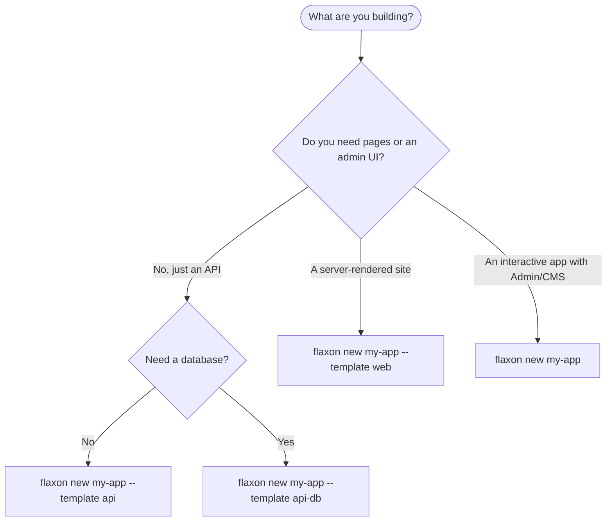
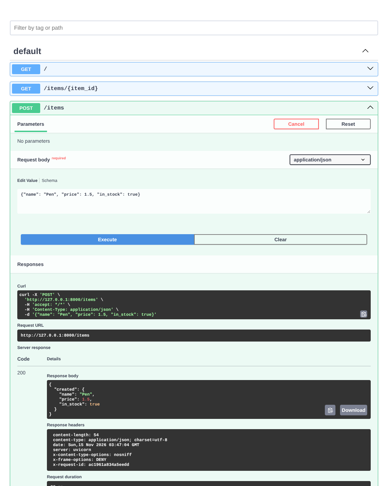
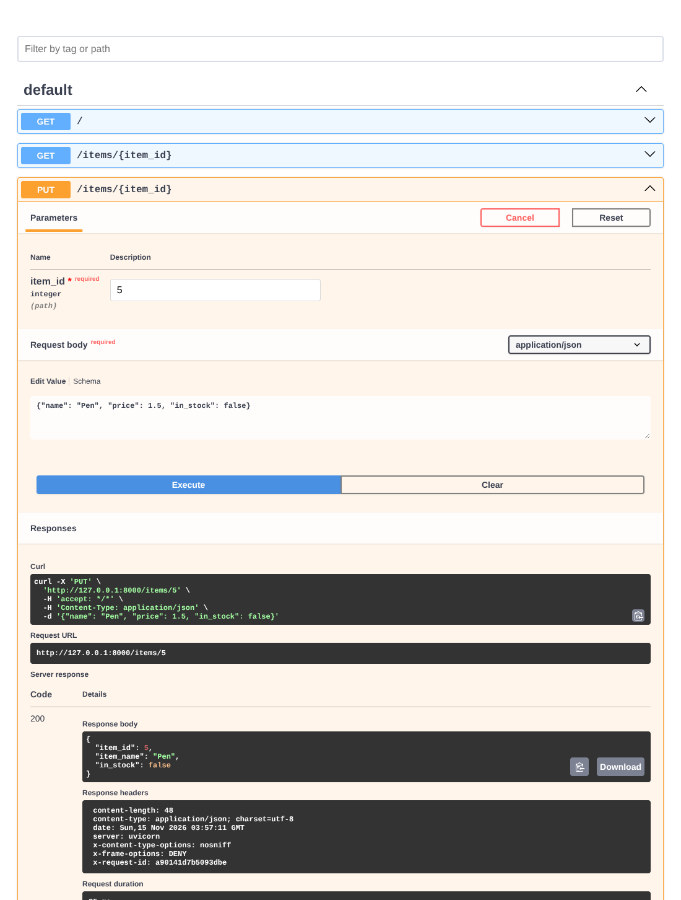
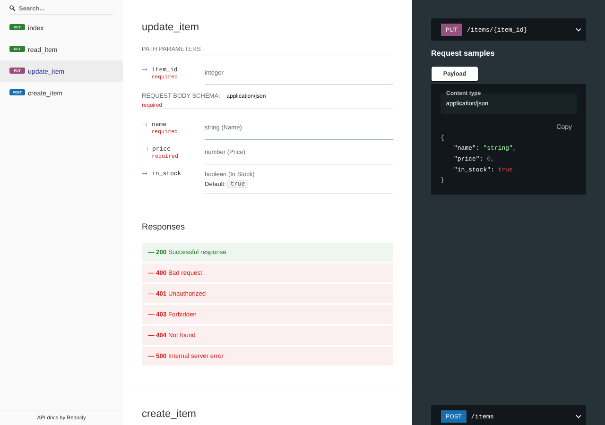
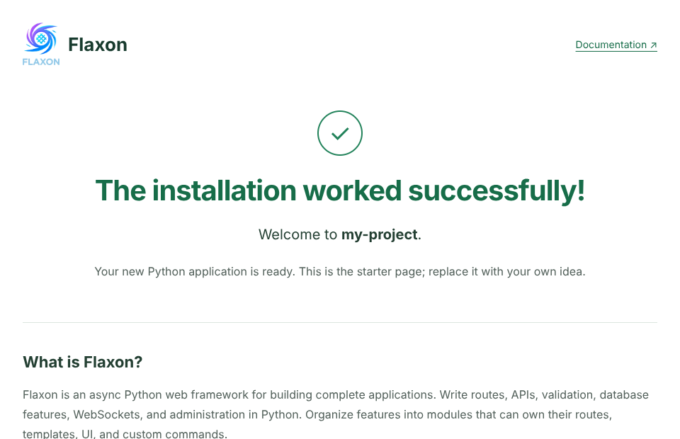
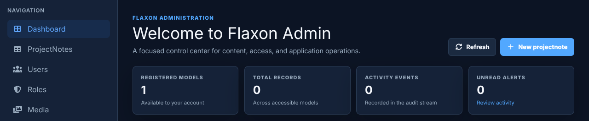
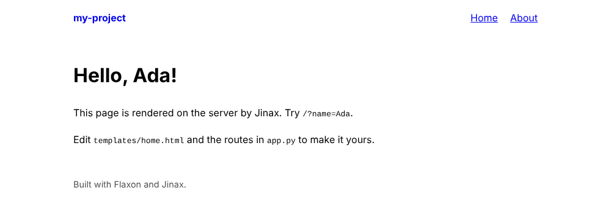

<div align="center">
  <a href="https://flaxon-website.vercel.app/">
    
  </a>
  <h1>Flaxon</h1>
  <p><strong>The Python full-stack framework.</strong></p>
  <p>Simple Python. Serious Applications.</p>

  <a href="https://pypi.org/project/flaxon/"></a>
  <a href="https://pypi.org/project/flaxon/"></a>
  <a href="https://github.com/aldanedev-create/flaxon/blob/main/LICENSE"></a>
  <a href="https://github.com/astral-sh/ruff"></a>

  <p>
    <a href="#install">Install</a> ·
    <a href="#choose-your-path">Choose your path</a> ·
    <a href="#path-1-backend-and-api">Backend</a> ·
    <a href="#path-2-full-stack">Full stack</a> ·
    <a href="#project-templates">Templates</a> ·
    <a href="#learn-more">Learn more</a>
  </p>
</div>

---

**Documentation**: <a href="https://flaxon-website.vercel.app/docs.html" target="_blank">https://flaxon-website.vercel.app/docs.html</a>

**Source code**: <a href="https://github.com/aldanedev-create/flaxon" target="_blank">https://github.com/aldanedev-create/flaxon</a>

---

Flaxon is an async-first Python full-stack framework with built-in Admin, CMS, authentication, database tools, WebSockets, and a modular application system. Build interactive applications with **Teloce**, complete server-rendered applications with **Jinax**, or combine both.

You do not have to start with the full stack. Begin with a single-file JSON API and interactive docs, or generate a complete application. It is the same framework either way, so you never have to rewrite to grow.

## Key features

The key features are:

- **One framework, any size**: start with a single-file API and grow into a full-stack app with Admin/CMS, without rewriting.
- **Fast to start**: `flaxon new` creates a working, tested project in one command, and the interactive docs are ready on day one.
- **Interactive API docs**: OpenAPI 3.1, Swagger UI at `/docs`, ReDoc at `/redoc`, with a "Try it out" button on every endpoint.
- **Plain Python types**: typed path and query parameters, and [Pydantic](https://docs.pydantic.dev/) request bodies. Invalid input gets a structured `422` error before your code runs.
- **Standards-based**: the API is described with [OpenAPI](https://www.openapis.org/) 3.1 and JSON Schema, so other tools can read it.
- **Async everywhere**: ASGI, WebSockets and background tasks.
- **Modular**: each feature owns its routes, models, UI and commands.
- **Batteries included**: Tortoise ORM with Python migrations, an Admin dashboard and CMS, and JWT authentication with Argon2 password hashing.
- **Secure by default**: trusted-host checks, security headers and request IDs.
- **Two ways to build pages**: **Teloce** for interactive components with TypeScript, **Jinax** for server-rendered templates, or both in one project.
- **Built-in operations endpoints**: `/health`, `/health/live`, `/health/ready` and `/metrics`.
- **Tested by design**: a `TestClient` that needs no running server, and every starter ships with its own tests.

## Requirements

- **Python 3.11+**
- [Pydantic](https://docs.pydantic.dev/) for request bodies (optional: `flaxon[pydantic]`)

## Install

Create and activate a virtual environment, then install Flaxon:

```bash
python -m pip install "flaxon[standard]"
```

<details>
<summary>First time using virtual environments?</summary>

```bash
python -m venv .venv
source .venv/bin/activate      # Windows PowerShell: .venv\Scripts\Activate.ps1
python -m pip install "flaxon[standard]"
```

</details>

## Choose your path

You do not need the whole framework to start. Pick the path that matches what you are building; you can move between them later.

| 🐍 **Backend and API** | 🧩 **Full stack** |
| --- | --- |
| JSON endpoints, microservices, mobile or SPA backends | Pages, an interactive UI, a database and an Admin/CMS |
| Start in one file, grow into modules | Starts as a modular project |
| Interactive docs at `/docs` | Welcome page, Admin dashboard, migrations |
| [**Go to the backend path →**](#path-1-backend-and-api) | [**Go to the full-stack path →**](#path-2-full-stack) |



## Path 1: Backend and API

### Create it

Create a file `main.py`:

```python
# main.py
from pydantic import BaseModel

from flaxon import Flaxon

app = Flaxon("hello", openapi=True)  # openapi=True turns on /docs, /redoc and /openapi.json


class Item(BaseModel):
    name: str
    price: float
    in_stock: bool = True


@app.get("/")
async def index():
    return {"message": "Hello, Flaxon"}


@app.get("/items/<int:item_id>")
async def read_item(item_id: int, q: str | None = None):
    return {"item_id": item_id, "q": q}


@app.post("/items")
async def create_item(item: Item):
    return {"created": item.model_dump()}
```

> [!NOTE]
> This example uses Pydantic, so install it with `python -m pip install "flaxon[standard,pydantic]"`. Path parameters are written `<int:item_id>` in Flaxon.

### Run it

```bash
flaxon run main:app --reload
```

<details>
<summary>About the command</summary>

`flaxon run main:app` runs the `app` object in `main.py` with Uvicorn. `--reload` restarts the server when you change the code, so use it only in development.

</details>

### Check it

Open <http://127.0.0.1:8000/items/5?q=somequery> in your browser. You will see:

```json
{"item_id": 5, "q": "somequery"}
```

### Interactive API docs

Now open <http://127.0.0.1:8000/docs>. Flaxon generated it from your code and types (using Swagger UI, which ships with Flaxon, so it works offline): every endpoint, its parameters and its request body, with a **Try it out** button.

<p align="center">
  
</p>

<details>
<summary>What happens if the data is wrong?</summary>

Send an item without a price and Flaxon rejects it before your function runs:

```json
{"error": {"code": "FX-VAL-001", "message": "Request validation failed.", "fields": {"price": ["Field required"]}}}
```

The response status is `422`, and every invalid field is listed.

</details>

### Alternative API documentation

And now, go to <http://127.0.0.1:8000/redoc>. You will see the alternative automatic documentation (provided by [ReDoc](https://github.com/Redocly/redoc), which ships with Flaxon, so it works offline), generated from the same code. The raw OpenAPI document is at <http://127.0.0.1:8000/openapi.json>.

### Example upgrade

Now modify `main.py` to receive a body from a `PUT` request. The body is the same `Item` class, and the item id comes from the path. Both are declared with standard Python types.

```python
# main.py
from pydantic import BaseModel

from flaxon import Flaxon

app = Flaxon("hello", openapi=True)  # openapi=True turns on /docs, /redoc and /openapi.json


class Item(BaseModel):
    name: str
    price: float
    in_stock: bool = True


@app.get("/")
async def index():
    return {"message": "Hello, Flaxon"}


@app.get("/items/<int:item_id>")
async def read_item(item_id: int, q: str | None = None):
    return {"item_id": item_id, "q": q}


@app.post("/items")
async def create_item(item: Item):
    return {"created": item.model_dump()}


@app.put("/items/<int:item_id>")
async def update_item(item_id: int, item: Item):
    return {"item_id": item_id, "item_name": item.name, "in_stock": item.in_stock}
```

The server reloads automatically, because you ran it with `--reload`.

### Interactive API docs upgrade

Go to <http://127.0.0.1:8000/docs> again. The interactive docs are updated automatically and now include the new `PUT` endpoint. Click **Try it out**, fill in the `item_id` and the body, and send the request straight from the browser.

<p align="center">
  
</p>

### Alternative API docs upgrade

And go to <http://127.0.0.1:8000/redoc>. The alternative documentation reflects the new path parameter and the request body too, including which fields are required and their defaults.

<p align="center">
  
</p>

### Recap

In summary, you declare **once** the types of the parameters and the body, as function parameters, using standard modern Python types. You do not learn a new syntax or the methods of a special library. It is just Python.

With that one declaration you get:

- **Type conversion**: `item_id: int` arrives as an `int`, and a path that is not an integer does not match the route.
- **Validation**: bad input is rejected with a clear, structured `422` that lists every invalid field.
- **Editor support**: `item.name` completes in your editor, because `Item` is an ordinary Python class.
- **Documentation**: interactive docs, a reference page and an OpenAPI document, all generated from the same code and always in sync with it.

### Keep going

Generate a complete backend project with modules, trusted-host protection and tests:

```bash
flaxon new my-api --template api
```

Need a database? Use `--template api-db` for Tortoise ORM, migrations and tests. See [project templates](#project-templates) to compare them.

## Path 2: Full stack

One command creates a modular application with a Teloce interface, a database, migrations and a protected Admin dashboard.

```bash
python -m pip install "flaxon[standard]"
flaxon new my-project --no-venv
cd my-project
python -m pip install -r requirements.txt
python management.py makemigrations
python management.py migrate
python management.py setup-admin
python management.py runserver
```

Open [localhost:8000](http://127.0.0.1:8000/) to see your application. The starter includes a welcome interface, feature modules, custom CLI commands, migrations, and a protected Admin dashboard.

<p align="center">
  
</p>

Then sign in at <http://127.0.0.1:8000/admin/login> with the account you created. The Admin lists your models, users, roles, media and activity.

<p align="center">
  
</p>

<details>
<summary>What did <code>flaxon new</code> create?</summary>

```text
my-project/
├── app.py              # app factory: wires settings, database, Admin and modules
├── settings.py         # configuration shared by the app and management.py
├── management.py       # check, makemigrations, migrate, setup-admin, runserver
├── models.py           # ORM models
├── admin.py            # which models appear in the Admin
├── migrations/         # generated Python migrations: commit these
├── modules/welcome/    # a feature module: its routes, UI and API client
│   ├── module.py
│   └── ui/             # Teloce component (HTML + TypeScript)
├── templates/          # Jinax (server-rendered) page
├── ui/app.html         # Teloce application shell
├── public/             # static files
├── flaxon_cli.py       # your own project commands
├── .env.example        # copy to .env
└── requirements.txt
```

</details>

<details>
<summary>I only want server-rendered pages, without Teloce</summary>

```bash
flaxon new my-project --template web
```

You get Jinax templates, static files, HTML escaping and tests. There is no database, admin or JavaScript build step.

<p align="center">
  
</p>

</details>

Models and Python migrations are integrated through Tortoise ORM. See the [settings and management guide](https://github.com/aldanedev-create/flaxon/blob/main/docs/guides/orm.md).

See the [getting started guide](https://github.com/aldanedev-create/flaxon/blob/main/docs/getting-started.md) for the complete setup, or follow the [full course](#learn-more).

## Project templates

`flaxon new` can start from the smallest template that fits. Run `flaxon new --list-templates` to see them.

| Template | Use it for | Includes |
| --- | --- | --- |
| `basic` | Learning, scripts, one-file services | Routes, interactive docs |
| `api` | A JSON API without persistence | Modules, OpenAPI docs, trusted hosts, tests |
| `api-db` | A JSON API with a database | `api` + Tortoise ORM, migrations, tests |
| `web` | A server-rendered website | Jinax templates, static files, tests |
| `fullstack` (default) | An interactive app with Admin | Teloce UI, Jinax, ORM, migrations, Admin/CMS |

```bash
flaxon new my-app --template api-db
```

See [Project templates](https://github.com/aldanedev-create/flaxon/blob/main/docs/guides/project-templates.md) for what each one installs and how to move between them.

## Generators and the CLI

Once you have a project, `flaxon generate` creates the boilerplate for a component. It refuses to overwrite a file that already exists.

```bash
flaxon generate controller Users     # Users_controller.py: routes for /api/Users
flaxon generate schema Users         # Users_schema.py: request validation
flaxon generate model Users          # Users_model.py: a Tortoise ORM model
flaxon generate service Users        # Users_service.py
flaxon generate middleware Users     # Users_middleware.py
flaxon generate task Users           # Users_task.py: background tasks with retry
```

Use `--path` to choose the output folder. Mount a generated controller with `app.include_router(router)`.

Other commands worth knowing:

| Command | What it does |
| --- | --- |
| `flaxon new NAME --template T` | Create a project ([templates](#project-templates)) |
| `flaxon run main:app --reload` | Run an app with Uvicorn |
| `flaxon routes main:app` | List every HTTP and WebSocket route |
| `flaxon doctor main:app` | Check configuration and routes |
| `flaxon test` | Run your tests |
| `flaxon shell` | Open an interactive Python shell |
| `flaxon docs` | Generate OpenAPI docs from your routes |
| `flaxon migrate`, `flaxon worker`, `flaxon schedule` | Migrations, background workers, scheduled tasks |

Run `flaxon --help` for the full list.

## Performance

Flaxon is built for I/O-bound work: APIs, web apps, dashboards and realtime features. It does not make CPU-heavy calculations faster; run those in worker processes.

We do not publish headline speed claims. The benchmarks live in the repository so you can measure your own workload on your own hardware:

```bash
git clone https://github.com/aldanedev-create/flaxon && cd flaxon
python -m pip install -e ".[dev]"
python -m pytest tests/performance --benchmark-only
```

Read the [performance guide](https://github.com/aldanedev-create/flaxon/blob/main/docs/performance.md) for what is measured and how to scale.

## Dependencies

To run an application, Flaxon needs three packages: **orjson** (fast JSON), **PyJWT** (authentication tokens) and **argon2-cffi** (password hashing). To serve it over HTTP you also need an ASGI server, which `flaxon[standard]` installs (Uvicorn).

`pip install flaxon` currently installs a few more packages. Each one is only used when you use its feature:

| Package | Used for |
| --- | --- |
| `tortoise-orm` | The ORM, migrations and the data behind the Admin |
| `teloce-py`, `minifyjs` | Compiling Teloce interfaces and minifying their production JavaScript |
| `pytscheck` | TypeScript type checking for Teloce |
| `python-dotenv` | Loading `.env` files |
| `pyyaml` | YAML output from the CLI |

The extras let your `requirements.txt` say exactly what your project uses, and the generated starters do. Install only what you need:

<details>
<summary>Optional dependencies (extras)</summary>

Install only what you need:

| Extra | Adds |
| --- | --- |
| `flaxon[standard]` | Uvicorn with WebSocket support, Jinja2, JWT, Argon2, YAML and `.env` support |
| `flaxon[pydantic]` | Pydantic request and response models |
| `flaxon[orm]` | Tortoise ORM |
| `flaxon[admin]` | Admin dashboard and CMS dependencies |
| `flaxon[teloce]` | Teloce compiler and MinifyJS |
| `flaxon[typecheck]` | TypeScript type checking for Teloce (also install `teloce-py[typecheck]`) |
| `flaxon[postgres]` | PostgreSQL driver |
| `flaxon[fullstack]` | Everything the full-stack starter needs |

</details>

## Learn more

### 🎥 Watch the full course

[](https://www.youtube.com/watch?v=tbqdrKcXywY)

Build and deploy a complete full-stack Project Manager app with Python, Flaxon, Teloce and TypeScript, from authentication and APIs to tests and deployment on Render (about 5.5 hours).

▶️ [Watch on YouTube](https://www.youtube.com/watch?v=tbqdrKcXywY)

### Tutorials

- **[Build a Discord clone and bot platform](https://github.com/aldanedev-create/flaxon/blob/main/docs/tutorials/discord-clone/index.md)**: a hands-on course of 19 lessons. You start from `flaxon new` and build the whole system yourself: authentication, permissions, bot tokens, realtime WebSockets, Admin and CMS, a Teloce SPA, tests and deployment. The finished, tested result lives in [`examples/discord_clone`](https://github.com/aldanedev-create/flaxon/tree/main/examples/discord_clone).
- [Getting started guide](https://github.com/aldanedev-create/flaxon/blob/main/docs/getting-started.md): the full setup for the starter project.

### Documentation

Visit the [Flaxon documentation](https://flaxon-website.vercel.app/docs.html) or browse the [repository guides](https://github.com/aldanedev-create/flaxon/blob/main/docs/index.md):

- [Teloce full-stack applications](https://github.com/aldanedev-create/flaxon/blob/main/docs/api/teloce.md)
- [Jinax server-rendered applications](https://github.com/aldanedev-create/flaxon/blob/main/docs/guides/jinax.md)
- [Admin and CMS](https://github.com/aldanedev-create/flaxon/blob/main/docs/guides/admin-cms.md)
- [ORM, settings and management commands](https://github.com/aldanedev-create/flaxon/blob/main/docs/guides/orm.md)
- [Modules](https://github.com/aldanedev-create/flaxon/blob/main/docs/guides/Modules.md)
- [Project templates](https://github.com/aldanedev-create/flaxon/blob/main/docs/guides/project-templates.md)
- [Deployment](https://github.com/aldanedev-create/flaxon/blob/main/docs/deployment.md)

### Examples

Explore the [example applications](https://github.com/aldanedev-create/flaxon/tree/main/examples), including a [modular Teloce shop](https://github.com/aldanedev-create/flaxon/tree/main/examples/teloce_modules_shop), a [taskboard](https://github.com/aldanedev-create/flaxon/tree/main/examples/teloce_taskboard) and a [school portal](https://github.com/aldanedev-create/flaxon/tree/main/examples/school_portal).

## Community and contributing

Created and maintained by **Aldane Hutchinson**. Contributions, documentation improvements and examples are welcome.

Report bugs and suggest features through [GitHub Issues](https://github.com/aldanedev-create/flaxon/issues). Read the [contribution guidelines](https://github.com/aldanedev-create/flaxon/blob/main/CONTRIBUTING.md) and [Code of Conduct](https://github.com/aldanedev-create/flaxon/blob/main/CODE_OF_CONDUCT.md) to get involved.

## Publishing releases

See [the publishing guide](https://github.com/aldanedev-create/flaxon/blob/main/docs/publishing.md) for `python scripts/publish.py`, TestPyPI, credentials, and release order.

## Security

Report vulnerabilities privately following [SECURITY.md](https://github.com/aldanedev-create/flaxon/blob/main/SECURITY.md).

## License

Flaxon is released under the [MIT license](https://github.com/aldanedev-create/flaxon/blob/main/LICENSE).
