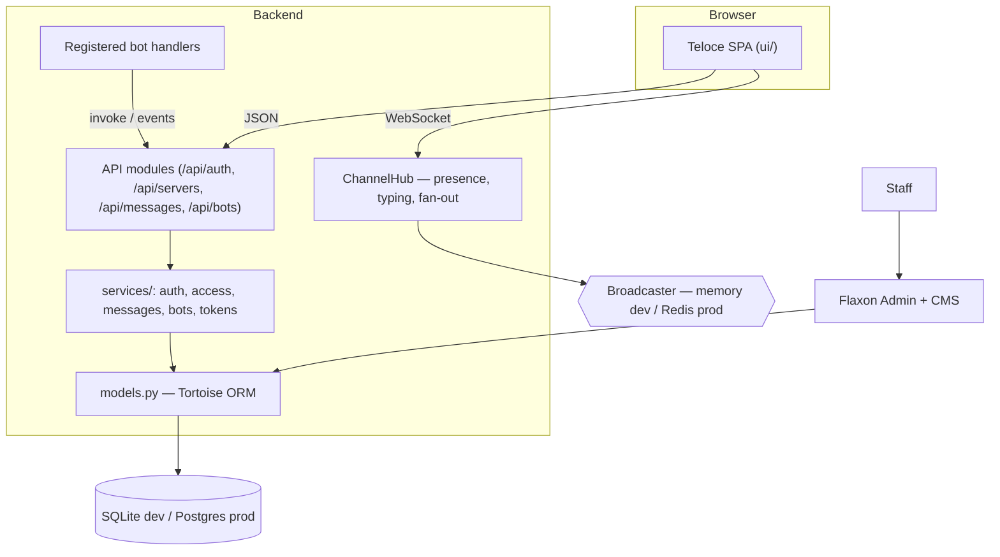

# Lesson 1 — Overview: the system you are about to build

> **Track position:** lesson 1 of 19. Nothing exists yet.

## Goal

Fix the shape of the system in your head before writing a single line. Every
later lesson is a decision you could defend in a design review; this lesson is
the map of those decisions.

## What you are building

A Discord-style chat app **and** a Discord-style bot platform on one backend:
three concerns stacked together.

1. **Identity & authorization** — who you are (accounts) and what you may do
   (server membership, roles, a permission bitmask).
2. **Chat** — servers, channels, messages, plus a live layer (presence, typing,
   new-message pushes) that sits *on top of* durable history.
3. **Extensibility** — a bot platform where third-party logic runs as registered
   handlers, not arbitrary code inside your web process.

## System design

Read the diagram as three guarantees:

- **The API is the only front door.** The human SPA and the bot invoke/event
  surface both go through it. That is precisely what makes the bot platform
  "Discord-style" rather than a separate system bolted on later.
- **Live traffic is recoverable.** Because messages are rows first, a dropped
  WebSocket is an inconvenience, not data loss — the client refetches history.
- **Bots never execute foreign code.** A bot is data (tokens, commands,
  subscriptions). Handlers live in your process. This is the single most
  important safety property of the design.

## The decisions you will make, in order

| Phase | Decision | Lesson |
|---|---|---|
| Identity | Hash passwords with argon2; never store plaintext | 5 |
| Web safety | CSRF-check every mutation; rate-limit by IP | 5, 16 |
| Authorization | Enforce private channels in the **database**, not the UI | 6 |
| Durability | Persist messages; treat presence/typing as ephemeral | 7, 10 |
| Extensibility | One-way-hash bot tokens; deliver events idempotently | 8, 9 |
| Scale | One hub per worker; hubs talk only via a broadcaster | 10, 11 |

## Checkpoint

You can state, in one sentence each, what `models.py`, `modules/`,
`services/`, `admin.py`, and `ui/` are each responsible for. If you cannot,
re-read the index — the rest of the course is built on that separation.

## Next

[Lesson 2 — Scaffold the app with `flaxon new`](02-scaffold.md).
