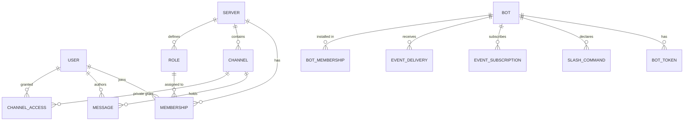

# Lesson 3 — The data model and migrations

> **Track position:** the app boots. Now give it something to remember.

## Goal

Encode the **authorization model** in the schema, so a bug in one route cannot
leak data that another route is allowed to see.

## System design



Two categories of state, and the split is deliberate:

- **Durable** — users, servers, channels, roles, memberships, messages, bots,
  tokens, commands, subscriptions, deliveries.
- **Ephemeral** — presence and typing are **not modelled**. They live in the
  realtime hub and are rebuilt from history on reconnect. Persisting them would
  buy you nothing and cost you a write on every keystroke.

## Step 1 — Model servers, channels, and private access

Every model file starts the same way — `models.py`:

```python
"""Domain models for the Discord-clone example."""
from __future__ import annotations

from flaxon.db import fields, Model


class Channel(Model):
    server = ForeignKeyField("models.Server", related_name="channels")
    name = CharField(max_length=100)
    is_private = BooleanField(default=False)


class ChannelAccess(Model):
    """Explicit grant letting a member read a private channel."""
    channel = ForeignKeyField("models.Channel", related_name="access_grants")
    user = ForeignKeyField("models.User", related_name="channel_access")
```

The critical design point: a private channel is **invisible because there is no
`ChannelAccess` row**, not because a UI forgot to hide it. Isolation is enforced
in the database. Any new read path that skips the access check still cannot see
the channel, because the query itself joins against grants.

## Step 2 — Model roles as a permission bitmask

```python
class Role(Model):
    server = ForeignKeyField("models.Server", related_name="roles")
    name = CharField(max_length=64)
    permissions = IntField(default=0)      # bitmask, see services/permissions.py
```

A single integer column carries every permission. Adding a permission is a new
bit constant — no migration, no join table, no query change.

## Step 3 — Store bot tokens one-way hashed

```python
class BotToken(Model):
    bot = ForeignKeyField("models.Bot", related_name="tokens")
    token_hash = CharField(max_length=64)     # SHA-256 hex
    token_prefix = CharField(max_length=12)   # display-only prefix
    revoked_at = DatetimeField(null=True)
```

The plaintext token is returned to the owner **exactly once** and never
persisted. If your database leaks, every bot token in it is still unusable.

## Step 4 — Give event deliveries an idempotency key

```python
class EventDelivery(Model):
    bot = ForeignKeyField("models.Bot", related_name="deliveries")
    event_type = CharField(max_length=60)
    idempotency_key = CharField(max_length=64, db_index=True)
    status = CharField(max_length=16, default="pending")
    attempt_count = IntField(default=0)
```

Retries are inevitable in a distributed system. The idempotency key is what
makes a retry safe: the same event delivered twice produces one row, not two
side effects.

## Step 5 — Generate and apply migrations

```bash
python management.py makemigrations
python management.py migrate
```

## Verify

`migrate` applies two migration sets: `models.0001_initial` and
`flaxon_admin.0001_initial`. Run it twice — the second run must be a clean no-op.
That no-op property is what lets the test suite (Lesson 18) run migrations in a
subprocess on every session without corrupting state.

## Why this way

- **Authorization in the schema** beats authorization in the view layer, because
  views get copied and drift. A new endpoint inherits safety by default.
- **`ChannelAccess` is deliberately not registered in Admin** (Lesson 12). It is
  pure authorization; exposing it as an editable admin form would let staff grant
  channel access without any of the permission checks the API enforces.
- **Bitmask permissions** trade readability of the raw integer for zero-migration
  extensibility. `services/permissions.py` restores readability with named
  constants and an `expand()` helper.

## Next

[Lesson 4 — App context and dependency injection](04-context-and-di.md).
