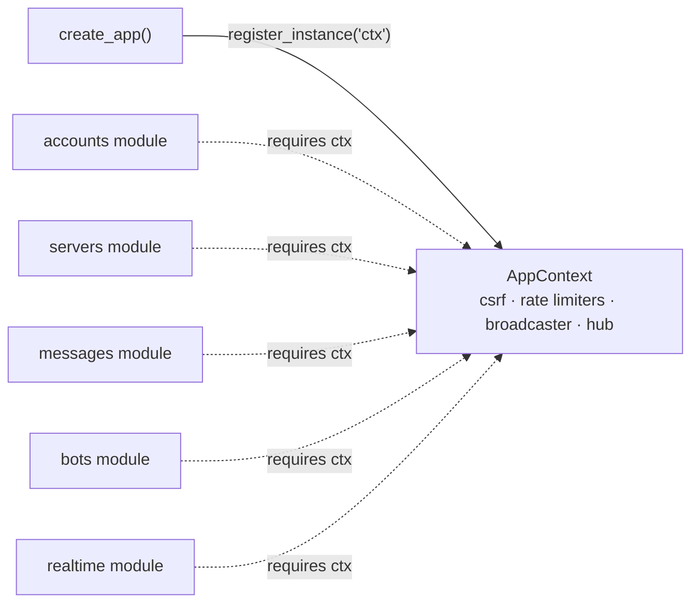

# Lesson 4 — App context and dependency injection

> **Track position:** models exist and migrate cleanly. Now wire collaborators.

## Goal

Stop modules from constructing what they need. They should **declare** it and
receive it — so a missing dependency is a startup error, not a 500 at 3 a.m.

## System design



Constructed once, shared by every request. The arrows from modules are dotted
because they are **declarations**, not constructions: the module never calls
`AppContext(...)` itself.

## Step 1 — Create `context.py`

Start with the imports — everything here wraps a *verified* Flaxon primitive
rather than reinventing one:

```python
"""The application context: process-wide collaborators shared by every module."""
from __future__ import annotations

import os

from flaxon.exceptions import TooManyRequests
from flaxon.security.csrf import CSRF
from flaxon.security.rate_limit import RateLimiter

from services.broadcaster import Broadcaster, MemoryBroadcaster
from services.hub import ChannelHub


class AppContext:
    def __init__(self, *, secret_key, broadcaster=None):
        self.csrf = CSRF(secret_key=secret_key)
        self.broadcaster = broadcaster or MemoryBroadcaster()
        self.hub = ChannelHub(self.broadcaster)
        self._limiters = {}
        self.rate_limit_enabled = os.environ.get(
            "RATE_LIMIT_ENABLED", "true"
        ).lower() != "false"

    async def guard(self, request, bucket, limit):
        if limit is None or not self.rate_limit_enabled:
            return
        if not await self._limiter(bucket, limit).check(request.scope):
            raise TooManyRequests("Too many requests — slow down and retry later")
```

Two things worth copying exactly:

- **The hub is built from the broadcaster**, not constructed independently. That
  single line is what makes Lesson 11 (multi-worker) a configuration change
  rather than a rewrite: swap the broadcaster, and every hub inherits it.
- **`rate_limit_enabled` is env-controlled.** Rate limits are keyed by client IP.
  In tests every request comes from `127.0.0.1`, so the shared bucket exhausts
  and produces meaningless 429s. `RATE_LIMIT_ENABLED=false` turns the guard into
  a no-op without touching a line of route code.

## Step 2 — Register the instance in `app.py`

```python
ctx = AppContext(secret_key=settings.SECRET_KEY, broadcaster=broadcaster)
app.container.register_instance("ctx", ctx)
```

## Step 3 — Declare the dependency, receive the parameter

```python
from flaxon.modules import FlaxonModule

from context import AppContext
from modules._common import require_csrf
from services import auth as auth_service

servers = FlaxonModule("servers")
servers.requires("ctx")                       # fail loudly at startup if missing

@servers.post("")
async def create_server(request, ctx: AppContext):
    require_csrf(ctx, request)
    user = await auth_service.require_user(request)
    ...
```

`requires("ctx")` is the whole contract. Mount this module on an app that forgot
to build a context and it raises during `create_app()`, not on the first request.

## Step 4 — Funnel every mutation through shared helpers

Create `modules/_common.py` with the helpers every module reuses:

| Helper | Responsibility |
|---|---|
| `require_csrf(ctx, request)` | Reject any mutation without a valid CSRF token |
| `json_body(request)` | Parse and validate the JSON payload |
| `authorize_server(...)` | Membership + permission check for a server |
| `authorize_channel(...)` | Membership + private-channel visibility check |

## Verify

Temporarily comment out the `register_instance("ctx", ctx)` line and boot the
app. You must get a startup failure naming the missing dependency — not a silent
`None` that 500s later. Restore the line.

Then confirm the rate-limit bypass works: set `RATE_LIMIT_ENABLED=false` and
hammer a login route; no 429s appear.

## Why this way

Central DI is what lets this project keep growing without becoming a ball of
mud. Each module is a self-contained bundle — routes plus its own UI — that
declares its needs and receives them. The alternative (each module importing and
constructing its own `CSRF`, `RateLimiter`, and hub) gives you five subtly
different rate-limit configurations and a hub per module, which is exactly the
bug Lesson 11 exists to demonstrate.

## Next

[Lesson 5 — Authentication](05-authentication.md).
