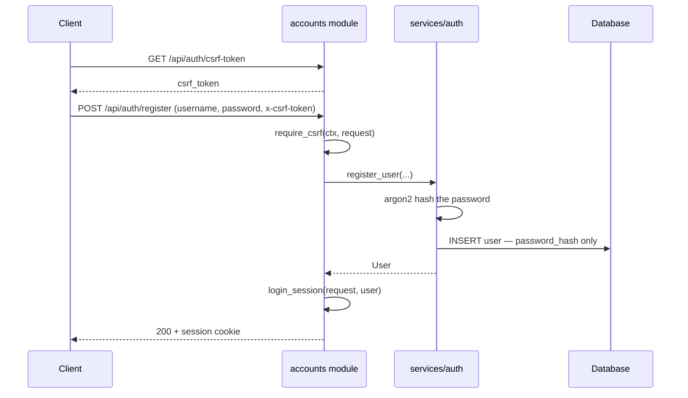
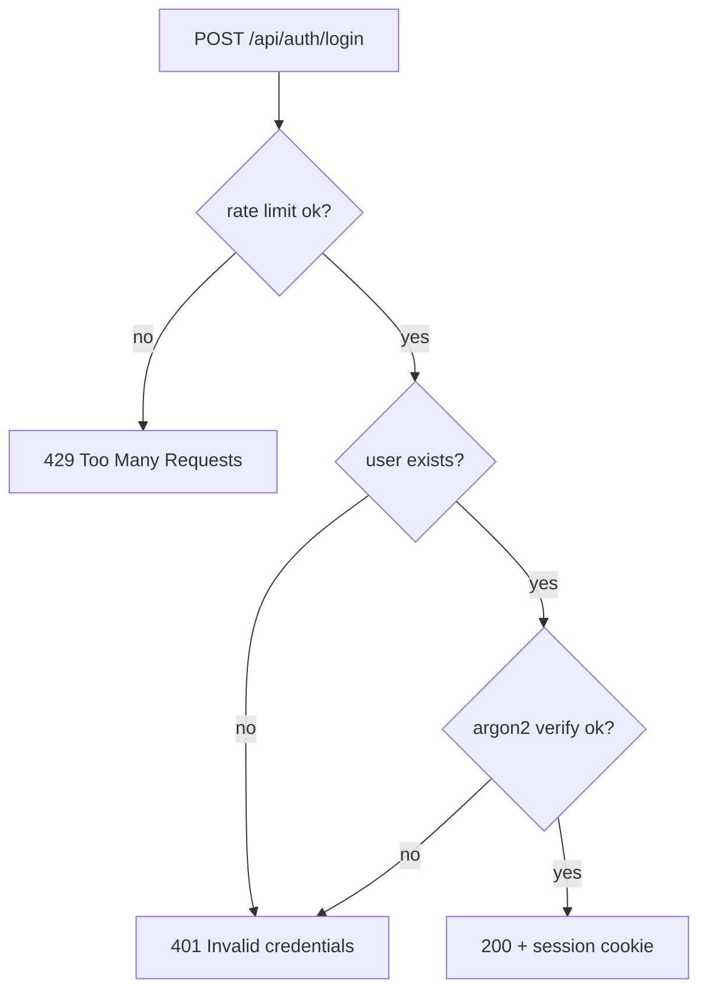

# Lesson 5 — Authentication

> **Track position:** the DI container is wired. Now let people sign up.

## Goal

Real accounts: argon2 password hashing, server-side sessions, CSRF on every
mutation, and errors that do not leak which usernames exist.

## System design



Note what is **absent** from that flow: the plaintext password is never written
anywhere and never echoes back in a response.

The login path deliberately collapses its failure modes:



Unknown user and wrong password return the **same** 401. That is
user-enumeration resistance: an attacker cannot harvest valid usernames by
reading error text.

## Step 1 — Create `services/auth.py`

`services/auth.py` — imports first:

```python
"""Authentication and session helpers."""
from __future__ import annotations

from flaxon.exceptions import Unauthorized
from flaxon.security.password import hash_password, verify_password
from models import User

SESSION_KEY = "uid"
MIN_PASSWORD_LENGTH = 8
MAX_USERNAME_LENGTH = 40


async def register_user(username: str, email: str, password: str) -> User:
    _validate_username(username)
    if len(password) < MIN_PASSWORD_LENGTH:
        raise ValueError(f"password must be at least {MIN_PASSWORD_LENGTH} characters")
    if await User.filter(username=username).exists():
        raise ValueError("username_taken")
    return await User.create(
        username=username,
        email=email,
        password_hash=hash_password(password),   # argon2 — never plaintext
    )


async def authenticate(username: str, password: str) -> User | None:
    user = await User.get_or_none(username=username)
    if user is None:
        return None                            # unknown user
    if not verify_password(password, user.password_hash):
        return None                            # wrong password
    return user                                # both failures collapse upstream


def login_session(request, user: User) -> None:
    request.session[SESSION_KEY] = user.id


def logout_session(request) -> None:
    request.session.pop(SESSION_KEY, None)


async def current_user(request) -> User | None:
    uid = request.session.get(SESSION_KEY)
    if uid is None:
        return None
    return await User.get_or_none(id=uid)


async def require_user(request) -> User:
    user = await current_user(request)
    if user is None:
        raise Unauthorized("Authentication required")
    return user
```

The split between `current_user` (returns `None`) and `require_user` (raises
401) gives you optional-auth and strict-auth from one primitive. Every other
module calls `require_user`.

## Step 2 — Create `modules/accounts.py`

```python
"""Accounts: registration, login, session lifecycle."""
from __future__ import annotations

from flaxon.exceptions import BadRequest, Unauthorized
from flaxon.modules import FlaxonModule

from context import AppContext
from modules._common import json_body, require_csrf, public_user
from services import auth as auth_service

accounts = FlaxonModule("accounts")
accounts.requires("ctx")


@accounts.get("/csrf-token")
async def csrf_token(request, ctx: AppContext):
    return {"csrf_token": ctx.csrf.generate(request)}


@accounts.post("/register")
async def register(request, ctx: AppContext):
    require_csrf(ctx, request)
    body = await json_body(request)
    try:
        user = await auth_service.register_user(
            body["username"], body.get("email", ""), body["password"]
        )
    except ValueError as exc:
        raise BadRequest(str(exc))           # username_taken · password too short
    auth_service.login_session(request, user)
    return {"user": public_user(user)}


@accounts.post("/login")
async def login(request, ctx: AppContext):
    require_csrf(ctx, request)
    await ctx.guard(request, "login", (5, 60))      # 5 attempts / minute / IP
    body = await json_body(request)
    user = await auth_service.authenticate(body["username"], body["password"])
    if user is None:
        raise Unauthorized("Invalid credentials")    # generic on purpose
    auth_service.login_session(request, user)
    return {"user": public_user(user)}


@accounts.post("/logout")
async def logout(request, ctx: AppContext):
    require_csrf(ctx, request)
    auth_service.logout_session(request)
    return {"ok": True}


@accounts.get("/me")
async def me(request):
    user = await auth_service.require_user(request)
    return {"user": public_user(user)}
```

Mount it:

```python
app.mount_module(accounts, prefix="/api/auth")
```

## Verify

```bash
# 1. fetch a CSRF token (the SPA does this automatically before any mutation)
curl -c cookies.txt http://127.0.0.1:8000/api/auth/csrf-token

# 2. register
curl -b cookies.txt -c cookies.txt -X POST http://127.0.0.1:8000/api/auth/register \
  -H 'x-csrf-token: <token>' -H 'content-type: application/json' \
  -d '{"username":"alice","email":"a@e.com","password":"password123"}'

# 3. the session now authenticates
curl -b cookies.txt http://127.0.0.1:8000/api/auth/me
```

Confirm all of these: register 200 · `me` 200 · wrong password 401 · unknown
user 401 (identical message) · duplicate username 400 (`username_taken`) ·
short password 400 · logout clears the session (subsequent `me` → 401).

## Why this way

- **argon2, not SHA-256** — password hashing must be slow and memory-hard so a
  stolen database cannot be brute-forced on GPUs.
- **Generic 401** — distinct "no such user" and "bad password" messages turn
  your login endpoint into a username oracle.
- **Server-side session cookie** — the session holds only the user id; there is
  no client-readable token to tamper with, and logout is authoritative because
  it destroys server state.
- **Rate limit on login specifically** — credentials are the one endpoint where
  brute force is cheap and catastrophic.
- **Minimum length enforced server-side** — client validation is a UX
  affordance, never a security control.

## Next

[Lesson 6 — Servers, channels, and permissions](06-servers-channels.md).
