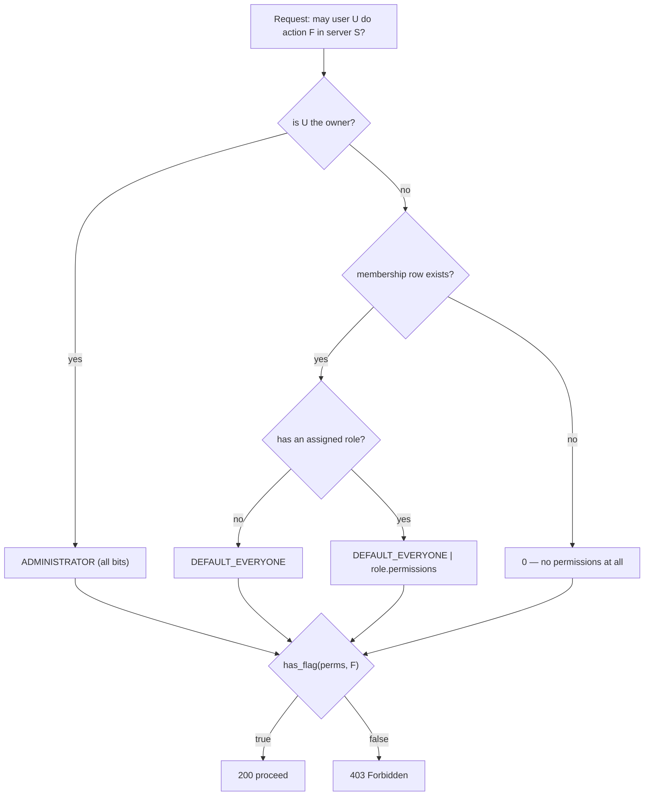
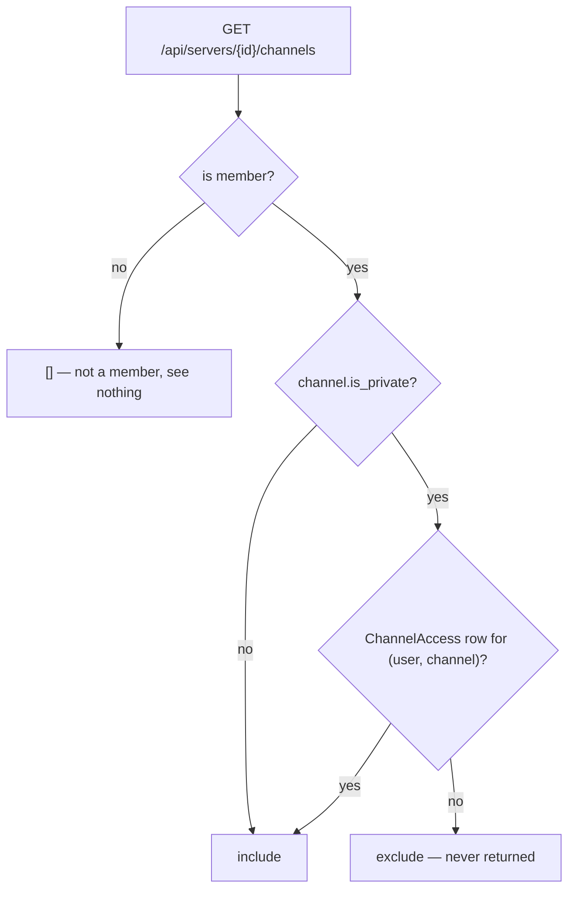

# Lesson 6 — Servers, channels, and permissions

> **Track position:** users can register and log in. Now give them somewhere to talk.

## Goal

Authorization: a permission bitmask, server membership, and private channels
that are **excluded at query time** rather than hidden in the UI.

## System design



The resolution order is the whole policy, and it fits in one function:
**owner → ADMINISTRATOR; non-member → 0; otherwise @everyone ORed with the
assigned role.**

Channel visibility is a separate decision, made in the query:



This is the payoff of Lesson 3: a private channel is absent from the result set
because **no grant row exists**, not because a template forgot to hide it.

## Step 1 — Create `services/permissions.py`

```python
"""Permission bitmask constants and helpers."""
from __future__ import annotations

VIEW_CHANNEL = 1
SEND_MESSAGES = 2
MANAGE_MESSAGES = 4
MANAGE_CHANNELS = 8
MANAGE_MEMBERS = 16
KICK_MEMBERS = 32
BAN_MEMBERS = 64
MANAGE_ROLES = 128
MANAGE_SERVER = 256
ADMINISTRATOR = 512

DEFAULT_EVERYONE = VIEW_CHANNEL | SEND_MESSAGES


def has_flag(permissions: int, flag: int) -> bool:
    return bool(permissions & flag)
```

Adding a permission later is a new constant — no migration, no join table, no
query change. That is the entire argument for a bitmask here.

## Step 2 — Create `services/access.py`

```python
async def get_membership(user_id: int, server_id: int) -> Membership | None:
    return await Membership.get_or_none(user_id=user_id, server_id=server_id)


async def effective_permissions(user_id: int, server_id: int) -> int:
    """Bitmask of what `user_id` may do in `server_id`."""
    server = await Server.get_or_none(id=server_id)
    if server is None:
        return 0
    if server.owner_id == user_id:
        return ADMINISTRATOR          # owner bypasses every check
    membership = await get_membership(user_id, server_id)
    if membership is None:
        return 0                      # not a member: no permissions at all
    permissions = DEFAULT_EVERYONE
    if membership.role_id:
        role = await Role.get_or_none(id=membership.role_id)
        if role is not None:
            permissions |= role.permissions
    return permissions


async def check_permission(user_id: int, server_id: int, flag: int) -> bool:
    return has_flag(await effective_permissions(user_id, server_id), flag)


async def is_member(user_id: int, server_id: int) -> bool:
    return await get_membership(user_id, server_id) is not None


async def can_view_channel(user_id: int, server_id: int, is_private: bool) -> bool:
    """A member can view any channel; private channels still require membership."""
    return await is_member(user_id, server_id)
```

Note the deliberate split of responsibility: `can_view_channel` answers
"membership", while **private-channel exclusion happens in the channel query**
in `modules/servers.py`. Keeping the grant check in the query is what makes it
impossible to forget.

## Step 3 — Create `modules/servers.py`

```python
servers = FlaxonModule("servers")
servers.requires("ctx")


@servers.post("")                                  # POST /api/servers/
async def create_server(request, ctx: AppContext):
    require_csrf(ctx, request)
    user = await auth_service.require_user(request)
    body = await json_body(request)
    server = await Server.create(name=body["name"], owner_id=user.id, ...)
    await Membership.create(server_id=server.id, user_id=user.id)   # owner joins
    await Channel.create(server_id=server.id, name="general")       # never empty
    return {"server": public_server(server)}


@servers.post("/{server_id}/channels")
async def create_channel(request, ctx: AppContext, server_id: int):
    require_csrf(ctx, request)
    user = await auth_service.require_user(request)
    await authorize_server(user.id, server_id, MANAGE_CHANNELS)     # 403 otherwise
    ...


@servers.post("/join")                             # join by invite code
async def join_server(request, ctx: AppContext):
    require_csrf(ctx, request)
    user = await auth_service.require_user(request)
    server = await Server.get_or_none(invite_code=body["invite_code"])
    await Membership.get_or_create(server_id=server.id, user_id=user.id)
    ...


@servers.post("/{server_id}/roles")                # create + assign roles
async def create_role(request, ctx: AppContext, server_id: int):
    require_csrf(ctx, request)
    user = await auth_service.require_user(request)
    await authorize_server(user.id, server_id, MANAGE_ROLES)
    ...
```

Mount it: `app.mount_module(servers, prefix="/api/servers")`.

## Verify

| Scenario | Expected |
|---|---|
| Create a server | 200, owner auto-joined, a default channel exists |
| Member (non-owner) creates a channel | **403** |
| Private channel, member without a grant | absent from the channel list |
| Join by invite code | 200, appears in the member list |
| Create role + assign to a member | 200, `effective_permissions` reflects it |

## Why this way

- **Owner ⇒ ADMINISTRATOR** rather than a special-cased `if owner` scattered
  across routes: one resolution function, no drift.
- **Non-member ⇒ 0**, not "some default". Membership is the gate; everything
  else is a refinement of it.
- **Private channels excluded in the query.** UI hiding is a courtesy; query
  exclusion is a guarantee. If someone adds a new endpoint that lists channels,
  they must go through the same filtered query.
- **`MANAGE_CHANNELS` / `MANAGE_ROLES` checked server-side** — the UI hiding a
  "create channel" button is UX, not authorization.

## Next

[Lesson 7 — Messages](07-messages.md).
