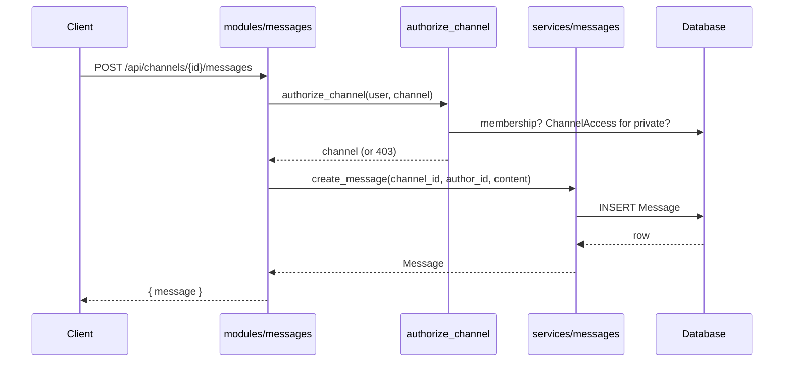
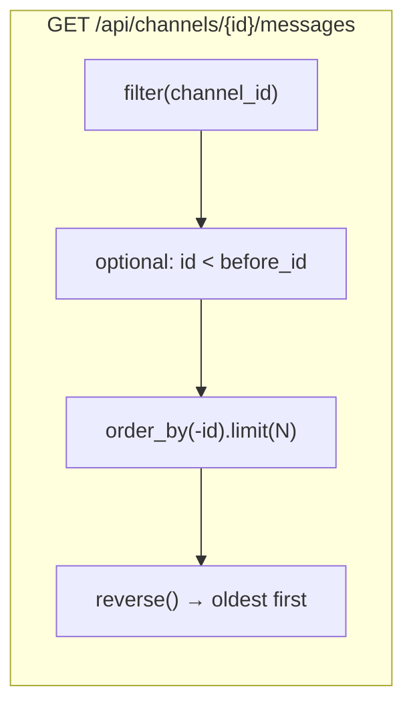

# Lesson 7 — Messages: durable history and cursor pagination

> **Track position:** servers and channels exist, and permissions resolve. Now put
> text in them.

## Goal

Messages are the **source of truth** for chat. Persist them first, paginate by
cursor, and never let a request touch a channel the caller cannot read.

## System design



The ordering is the design: **authorize → persist → return**. There is no
"persist then check" path, so a failed authorization can never leave a row
behind.



Cursor pagination by `id` (not `OFFSET`) is stable: two concurrent inserts
cannot shift a page out from under a client that is scrolling, and the query
stays on the `(channel_id, created_at)` index.

## Step 1 — Create `services/messages.py`

Imports first — this is the complete top of the file:

```python
"""Message persistence and history pagination."""
from __future__ import annotations

from models import Message

MAX_MESSAGE_LENGTH = 4000
DEFAULT_HISTORY_LIMIT = 50
MAX_HISTORY_LIMIT = 200
```

Then the two functions:

```python
async def create_message(
    channel_id: int,
    *,
    author_id: int | None = None,
    author_bot_id: int | None = None,
    content: str,
    message_type: int = Message.TYPE_USER,
) -> Message:
    content = (content or "").strip()
    if not content:
        raise ValueError("empty_message")
    if len(content) > MAX_MESSAGE_LENGTH:
        raise ValueError("message_too_long")
    if author_id is None and author_bot_id is None:
        raise ValueError("message_needs_author")
    return await Message.create(
        channel_id=channel_id,
        author_id=author_id,
        author_bot_id=author_bot_id,
        content=content,
        type=message_type,
    )


async def channel_history(
    channel_id: int,
    before_id: int | None = None,
    limit: int = DEFAULT_HISTORY_LIMIT,
) -> list[dict]:
    limit = max(1, min(limit, MAX_HISTORY_LIMIT))
    query = Message.filter(channel_id=channel_id)
    if before_id is not None:
        query = query.filter(id__lt=before_id)
    rows = await query.order_by("-id").limit(limit)
    rows.reverse()                       # newest-first query → oldest-first page
    return [row.to_public() for row in rows]
```

> **Why `ValueError` and not `BadRequest`?** The service layer is
> transport-agnostic; it reports a domain rule violation. The module translates
> it into HTTP (`except ValueError: raise BadRequest(...)`). Keeping HTTP out of
> services is what makes them testable without a client.

## Step 2 — Create `modules/messages.py`

Complete header, then the routes:

```python
"""Channel messages: durable history and live delivery."""
from __future__ import annotations

from flaxon.exceptions import BadRequest, NotFound
from flaxon.modules import FlaxonModule

from context import AppContext
from models import Channel, Message
from modules._common import authorize_channel, int_param, json_body
from services import auth as auth_service
from services.messages import MAX_HISTORY_LIMIT, create_message

messages = FlaxonModule("messages")
messages.requires("ctx")

MESSAGE_CREATE_LIMIT = (20, 10)          # (requests, window_seconds)


async def _channel_and_server(channel_id: int, user_id: int) -> tuple[Channel, int]:
    channel = await Channel.get_or_none(id=channel_id)
    if channel is None:
        raise NotFound("Unknown channel")
    await authorize_channel(user_id, channel)   # 403 unless member (+ grant)
    return channel, channel.server_id


@messages.get("/<channel_id>/messages")
async def history(request, channel_id):
    user = await auth_service.require_user(request)
    cid = int_param(channel_id, "channel")
    channel = await Channel.get_or_none(id=cid)
    if channel is None:
        raise NotFound("Unknown channel")
    await authorize_channel(user.id, channel)
    before = request.query_params.get("before")
    limit = request.query_params.get("limit")
    before_id = int(before) if before and before.isdigit() else None
    limit_i = int(limit) if limit and limit.isdigit() else None
    if limit_i is not None:
        limit_i = max(1, min(limit_i, MAX_HISTORY_LIMIT))
    from services.messages import channel_history

    rows = await channel_history(cid, before_id=before_id, limit=limit_i or 50)
    return {"items": rows}


@messages.post("/<channel_id>/messages")
async def create(request, ctx: AppContext, channel_id):
    await ctx.guard(request, "msg", MESSAGE_CREATE_LIMIT)
    user = await auth_service.require_user(request)
    cid = int_param(channel_id, "channel")
    channel, server_id = await _channel_and_server(cid, user.id)
    payload = await json_body(request)
    content = str(payload.get("content", ""))
    try:
        message = await create_message(cid, author_id=user.id, content=content)
    except ValueError as exc:
        raise BadRequest(str(exc))
    await ctx.hub.broadcast(cid, {
        "type": "message.create",
        "server_id": server_id,
        "channel_id": cid,
        "message": message.to_public(),
    })
    return {"message": message.to_public()}
```

Mount it in `app.py`:

```python
from modules import messages

app.mount_module(messages, prefix="/api/channels")
```

Two conventions to notice:

- `int_param()` turns a non-numeric path segment into a **404**, not a 500.
- `ctx.guard(request, "msg", (20, 10))` applies the rate limit from Lesson 4
  *before* any database work.

## Step 3 — Delete (author or owner)

```python
@messages.delete("/<channel_id>/messages/<message_id>")
async def delete_message(request, ctx: AppContext, channel_id, message_id):
    user = await auth_service.require_user(request)
    cid = int_param(channel_id, "channel")
    mid = int_param(message_id, "message")
    channel, server_id = await _channel_and_server(cid, user.id)
    message = await Message.get_or_none(id=mid, channel_id=cid)
    if message is None:
        raise NotFound("Unknown message")
    if message.author_id != user.id:
        from services.access import is_member
        from services.permissions import ADMINISTRATOR, has_flag, effective_permissions

        perms = await effective_permissions(user.id, server_id)
        if not (has_flag(perms, ADMINISTRATOR) and await is_member(user.id, server_id)):
            raise BadRequest("You can only delete your own messages")
    await message.delete()
    await ctx.hub.broadcast(cid, {
        "type": "message.delete",
        "server_id": server_id,
        "channel_id": cid,
        "message_id": mid,
    })
    return {"ok": True}
```

The `channel_id=cid` filter in the lookup matters: without it, guessing another
channel's message id would let a member of *any* channel delete it.

## Verify

| Scenario | Expected |
|---|---|
| Post a message | 200, `{ message: { id, content, ... } }` |
| Post an empty message | **400** `empty_message` |
| Read history with `?limit=10` | at most 10 rows, oldest first |
| Read history with `?before=<oldest id>` | strictly older rows |
| Non-member reads a channel | **403** |
| Member deletes another's message (non-owner) | **400** |

## Why this way

- **Cursor over offset.** `id < before_id` cannot skip or duplicate rows when
  messages arrive mid-scroll, and it stays index-friendly at any page depth.
- **Validation lives in the service.** The same rules apply whether the caller
  is a user, a bot (Lesson 9), or a test.
- **Every message row is author-explicit** (`author` XOR `author_bot`) so the UI
  can render a bot reply with the same code path as a human one.
- **Broadcast after commit.** There is no "event sent, write failed" window; a
  client that misses the event still has the row.

## Next

[Lesson 8 — Bot tokens and slash commands](08-bot-tokens-commands.md).
