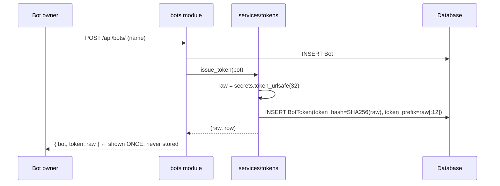
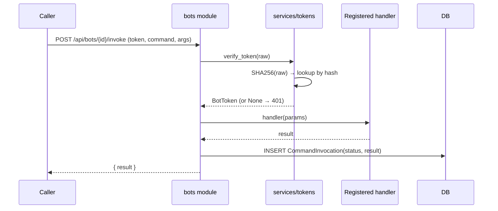

# Lesson 8 — Bot tokens and slash commands

> **Track position:** humans can chat. Now let programs talk to the same API.

## Goal

A bot platform: users create bots, receive a **one-time** token, register slash
commands, and invoke them — without ever letting a bot run arbitrary code.

## System design





The security property is visible in the second diagram: authentication is a
**hash lookup**. The database contains only hashes, so a full DB disclosure
still yields no usable bot credentials.

## Step 1 — Create `services/tokens.py`

```python
# services/tokens.py
from __future__ import annotations

import hashlib
import secrets
from datetime import datetime, timezone

from models import BotToken


def _hash_token(raw: str) -> str:
    return hashlib.sha256(raw.encode("utf-8")).hexdigest()


async def issue_token(bot: Bot, label: str = "default") -> tuple[str, BotToken]:
    raw = secrets.token_urlsafe(32)
    row = await BotToken.create(
        bot=bot,
        label=label,
        token_hash=_hash_token(raw),
        token_prefix=raw[:12],        # display-only, never sufficient to authenticate
    )
    return raw, row                   # raw is returned here and nowhere else


async def verify_token(raw: str) -> BotToken | None:
    row = await BotToken.get_or_none(token_hash=_hash_token(raw), revoked_at=None)
    return row


async def revoke_token(token_id: int) -> None:
    await BotToken.filter(id=token_id).update(revoked_at=datetime.now(timezone.utc))
```

`token_prefix` exists purely so a UI can show `abc123…` and a human can tell two
tokens apart. It is never used to authenticate.

> **Why SHA-256 here and argon2 for passwords?** A bot token is 256 bits of
> entropy — already unguessable, so slow hashing buys nothing. Passwords are
> low-entropy and *must* be slow. Using the right primitive for each is the
> point; using argon2 for tokens would just burn CPU on every invoke.

## Step 2 — Create `modules/bots.py`

```python
# modules/bots.py
from __future__ import annotations

from flaxon.exceptions import BadRequest, Forbidden, NotFound

from context import AppContext
from models import (
    Bot,
    BotMembership,
    BotToken,
    EventSubscription,
    SlashCommand,
)
from modules._common import int_param, json_body, require_csrf
from services import auth as auth_service
from services.bots import execute_command
from services.tokens import issue_token, revoke_token
from services.access import is_member


bots = FlaxonModule("bots")
bots.requires("ctx")


@bots.post("")                                     # POST /api/bots/
async def create_bot(request, ctx: AppContext):
    require_csrf(ctx, request)
    user = await auth_service.require_user(request)
    body = await json_body(request)
    bot = await Bot.create(name=body["name"], owner_id=user.id, ...)
    raw, _row = await tokens.issue_token(bot)
    return {"bot": public_bot(bot), "token": raw}  # the only time it is visible


@bots.post("/{bot_id}/join")
async def join_server(request, ctx: AppContext, bot_id: int):
    require_csrf(ctx, request)
    user = await auth_service.require_user(request)
    bot = await Bot.get_or_none(id=bot_id)
    if bot.owner_id != user.id:
        raise Forbidden("Only the bot owner can install this bot")
    await BotMembership.get_or_create(bot_id=bot_id, server_id=body["server_id"])
    ...


@bots.post("/{bot_id}/commands")
async def add_command(request, ctx: AppContext, bot_id: int):
    require_csrf(ctx, request)
    ...
    await SlashCommand.create(bot_id=bot_id, name=body["name"], ...)


@bots.post("/{bot_id}/invoke")
async def invoke(request, ctx: AppContext, bot_id: int):
    body = await json_body(request)
    tok = await tokens.verify_token(body["token"])
    if tok is None or tok.bot_id != bot_id:
        raise Unauthorized("Invalid bot token")
    cmd = await SlashCommand.get_or_none(bot_id=bot_id, name=body["command"])
    if cmd is None:
        raise NotFound("Unknown command")
    result = await bot_service.run_command(cmd, body.get("params", {}))
    await CommandInvocation.create(bot_id=bot_id, command_id=cmd.id,
                                   status="ok", result=result)
    return {"result": result}


@bots.get("/{bot_id}/tokens")
async def list_tokens(request, bot_id: int):
    ...
    return {"tokens": [{"id": t.id, "label": t.label,
                        "token_prefix": t.token_prefix,
                        "revoked_at": t.revoked_at} for t in rows]}


@bots.delete("/tokens/{token_id}")
async def revoke(request, ctx: AppContext, token_id: int):
    require_csrf(ctx, request)
    ...
    await tokens.revoke_token(token_id)
    return {"ok": True}
```

Mount it: `app.mount_module(bots, prefix="/api/bots")`.

## Step 3 — Register handlers (bots are data, code is yours)

```python
@command("ping")
async def ping(params):
    return "pong!"
```

One gotcha worth internalising: the `@command("ping")` decorator registers a
handler **in your process**, while `SlashCommand` is the **persisted row** the
invoke API authorises against. You need both — the decorator alone gives you
`404 Unknown command`, because `/invoke` looks up the row, not the registry.

## Verify

| Scenario | Expected |
|---|---|
| Create a bot | 200 with a token, shown once |
| Query `BotToken` by `token_prefix` | exactly 1 row, and it holds a **hash**, not the plaintext |
| Invoke `/ping` with the token | `{"result": "pong!"}` |
| Invoke with a revoked token | **401** |
| Invoke a command with no `SlashCommand` row | **404** |
| Install a bot you do not own | **403** |

## Why this way

- **One-way hashed tokens** — DB disclosure does not compromise credentials;
  the plaintext existed only in one HTTP response.
- **Bot-owned, owner-controlled** — only the owner installs or revokes, so a
  leaked token is revocable by the person who made it.
- **Invocations are rows** — `CommandInvocation` gives you an audit trail and
  makes bot behaviour debuggable after the fact.
- **No `eval`, no plugins, no user code** — extensibility comes from data plus
  handlers *you* ship. This is the line between a bot platform and a remote code
  execution vulnerability.

## Next

[Lesson 9 — Bot events and idempotent delivery](09-bot-events.md).
