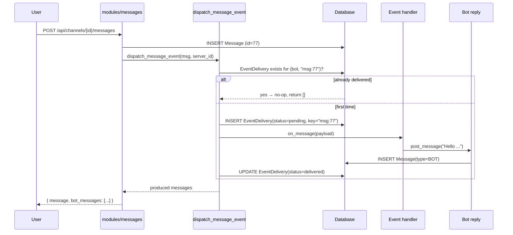
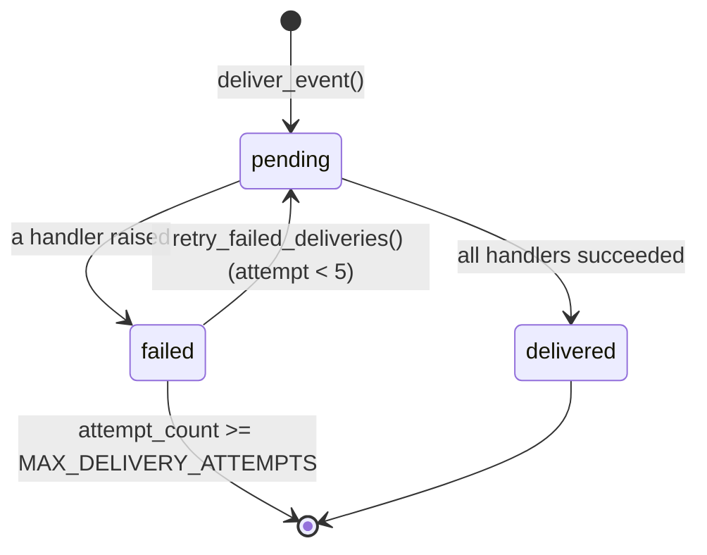

# Lesson 9 — Bot events: subscriptions, idempotency, retries

> **Track position:** bots answer `/ping` when invoked. Now they should react on
> their own, when something happens in a channel.

## Goal

An event dispatcher: bots subscribe to `message.create`, and every dispatch is
**idempotent per (bot, key)** and **retried with backoff** — the same contract a
real webhook system has to honour.

## System design





The idempotency key is `f"msg:{message.id}"`. Because the message id is
allocated *before* dispatch, a retry can never re-run the handler for the same
message — the second call finds the `delivered` row and returns immediately.

## Step 1 — Extend `services/bots.py`

The imports and registries at the top of the file:

```python
"""Bot platform: safe, in-process command and event execution."""
from __future__ import annotations

import asyncio
from dataclasses import dataclass, field
from datetime import datetime, timezone

from models import (
    Bot,
    BotMembership,
    CommandInvocation,
    EventDelivery,
    EventSubscription,
    Message,
    SlashCommand,
)
from services.messages import create_message

MAX_DELIVERY_ATTEMPTS = 5

COMMAND_HANDLERS: dict[str, callable] = {}
EVENT_HANDLERS: dict[str, list[callable]] = {}


def command(name: str):
    def decorator(fn):
        COMMAND_HANDLERS[name] = fn
        return fn
    return decorator


def event_handler(event_type: str):
    def decorator(fn):
        EVENT_HANDLERS.setdefault(event_type, []).append(fn)
        return fn
    return decorator
```

A `BotContext` gives handlers a narrow, safe API — they can post messages, and
nothing else:

```python
@dataclass
class BotContext:
    bot: Bot
    server_id: int | None = None
    channel_id: int | None = None
    user_id: int | None = None
    produced: list[Message] = field(default_factory=list)

    async def post_message(self, content: str) -> Message:
        message = await create_message(
            self.channel_id,
            author_bot_id=self.bot.id,
            content=content,
            message_type=Message.TYPE_BOT,
        )
        self.produced.append(message)
        return message


@event_handler("message.create")
async def on_message(ctx: BotContext, payload: dict) -> None:
    content = (payload.get("content") or "").lower()
    if "!hello" in content or ctx.bot.name.lower() in content:
        author_id = payload.get("author_id")
        await ctx.post_message(f"Hello <@{author_id}>! I'm {ctx.bot.name}. Try /ping.")
```

## Step 2 — Delivery with idempotency and retry

```python
async def attempt_delivery(bot: Bot, delivery: EventDelivery) -> tuple[EventDelivery, list[Message]]:
    handlers = EVENT_HANDLERS.get(delivery.event_type, [])
    ctx = BotContext(
        bot=bot,
        server_id=delivery.payload.get("server_id"),
        channel_id=delivery.payload.get("channel_id"),
        user_id=delivery.payload.get("author_id"),
    )
    delivery.attempt_count += 1
    try:
        for handler in handlers:
            await handler(ctx, delivery.payload)
        delivery.status = EventDelivery.STATUS_DELIVERED
        delivery.delivered_at = datetime.now(timezone.utc)
        delivery.last_error = None
    except Exception as exc:
        delivery.status = EventDelivery.STATUS_FAILED
        delivery.last_error = str(exc)[:500]
    await delivery.save()
    return delivery, ctx.produced


async def deliver_event(bot, event_type, payload, idempotency_key) -> tuple[EventDelivery, list[Message]]:
    existing = await EventDelivery.get_or_none(
        bot_id=bot.id, idempotency_key=idempotency_key, status=EventDelivery.STATUS_DELIVERED
    )
    if existing is not None:
        return existing, []                       # already delivered: no-op
    subscription = await EventSubscription.get_or_none(
        bot_id=bot.id, event_type=event_type, is_enabled=True
    )
    delivery = await EventDelivery.create(
        bot=bot,
        subscription=subscription,
        event_type=event_type,
        idempotency_key=idempotency_key,
        payload=payload,
        status=EventDelivery.STATUS_PENDING,
    )
    return await attempt_delivery(bot, delivery)


async def retry_failed_deliveries() -> list[tuple[EventDelivery, list[Message]]]:
    failed = await EventDelivery.filter(status=EventDelivery.STATUS_FAILED).all()
    results = []
    for delivery in failed:
        if delivery.attempt_count >= MAX_DELIVERY_ATTEMPTS:
            continue
        await asyncio.sleep(min(2 ** delivery.attempt_count, 8))   # exponential backoff
        bot = await Bot.get(id=delivery.bot_id)
        results.append(await attempt_delivery(bot, delivery))
    return results
```

## Step 3 — Fan out from message creation

```python
async def dispatch_message_event(message: Message, server_id: int, hub=None) -> list[Message]:
    payload = {
        "server_id": server_id,
        "channel_id": message.channel_id,
        "author_id": message.author_id,
        "content": message.content,
        "message_id": message.id,
    }
    produced: list[Message] = []
    subscriptions = (
        await EventSubscription.filter(event_type="message.create", is_enabled=True)
        .prefetch_related("bot")
        .all()
    )
    for sub in subscriptions:
        bot = sub.bot
        membership = await BotMembership.get_or_none(server_id=server_id, bot_id=bot.id)
        if membership is None:
            continue                              # not installed here → no event
        _delivery, messages = await deliver_event(
            bot, "message.create", payload, idempotency_key=f"msg:{message.id}"
        )
        produced.extend(messages)
    return produced
```

Wire it into the message route from Lesson 7 — append inside `create()`:

```python
from services.bots import dispatch_message_event

    produced = await dispatch_message_event(message, server_id, hub=ctx.hub)
    return {"message": message.to_public(), "bot_messages": [m.to_public() for m in produced]}
```

Bot replies are **ordinary message rows**, so they appear in history, survive a
reconnect, and need no special rendering.

## Verify

| Scenario | Expected |
|---|---|
| Send a message mentioning the bot | 200, `bot_messages` contains the reply |
| Send the same content again | **exactly 2** `EventDelivery` rows, not 4 |
| Query `EventDelivery` by `idempotency_key="msg:<id>"` | 1 row, `status=delivered` |
| Bot not a member of the server | no delivery row at all |
| Handler raises | `status=failed`, `last_error` set, request still 200 |

## Why this way

- **Idempotency is a database constraint, not a flag.** A retry cannot double-post
  even if two workers dispatch concurrently, because the key lookup happens in
  the same transaction boundary as the insert.
- **Failures are rows.** `EventDelivery.attempt_count` / `last_error` make
  "why didn't the bot reply?" answerable without logs archaeology.
- **Handlers are `async` functions you ship.** No `eval`, no user code, no plugin
  sandbox — this is the line between a bot platform and an RCE.
- **Delivery is fan-out by membership**, so a bot in server A never sees traffic
  from server B.

## Next

[Lesson 10 — Realtime hub and WebSockets](10-realtime-hub.md).
