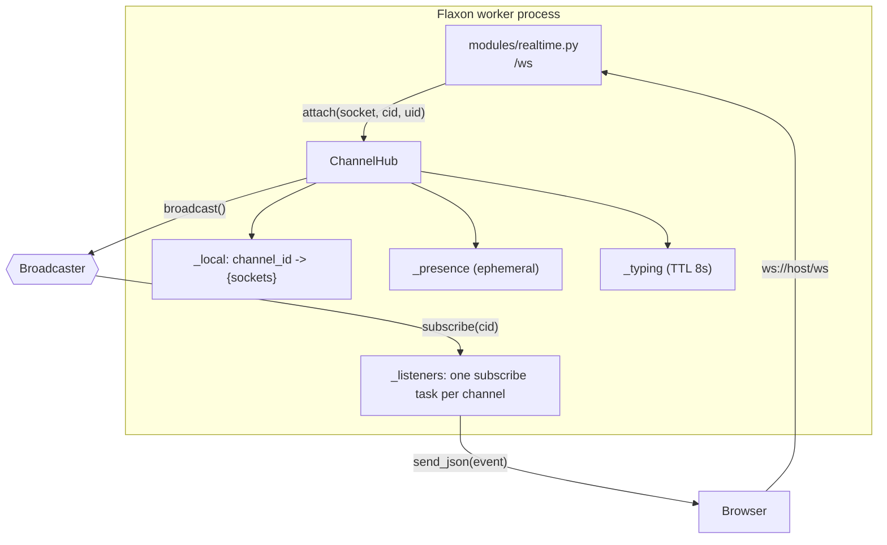
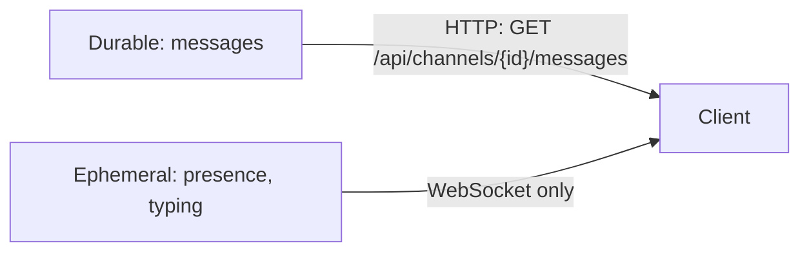

# Lesson 10 — Realtime: ChannelHub and the WebSocket module

> **Track position:** chat persists, and bots react. Now make it live.

## Goal

One WebSocket per browser, a per-process `ChannelHub` that owns presence and
typing, and a **Broadcaster** abstraction so the hub never talks directly to
another hub.

## System design



The critical separation:



**Persist first, broadcast second.** A dropped socket loses only presence; the
history is always re-fetchable. Presence and typing are the only state that lives
purely in memory, and that is deliberate — they have no value after a restart.

## Step 1 — Create `services/broadcaster.py`

Full file header:

```python
"""Pluggable broadcast medium for the realtime hub."""
from __future__ import annotations

import abc
import asyncio
from collections import defaultdict


class Broadcaster(abc.ABC):
    @abc.abstractmethod
    async def publish(self, channel: str, message: dict) -> None: ...

    @abc.abstractmethod
    def subscribe(self, channel: str):
        """Return an async iterator yielding messages published to `channel`."""
        ...

    async def close(self) -> None:
        return None
```

The in-process implementation — note that its scope is **per instance**, which is
exactly what Lesson 11 exploits:

```python
class MemoryBroadcaster(Broadcaster):
    def __init__(self, max_queue: int = 1024) -> None:
        self._subscribers: dict[str, set[asyncio.Queue]] = defaultdict(set)
        self._max_queue = max_queue

    async def publish(self, channel: str, message: dict) -> None:
        for queue in list(self._subscribers.get(channel, ())):
            try:
                queue.put_nowait(message)
            except asyncio.QueueFull:
                try:                        # drop the oldest rather than block
                    queue.get_nowait()
                    queue.put_nowait(message)
                except asyncio.QueueEmpty:
                    pass

    def subscribe(self, channel: str):
        queue: asyncio.Queue = asyncio.Queue(maxsize=self._max_queue)
        self._subscribers[channel].add(queue)

        async def generator():
            try:
                while True:
                    yield await queue.get()
            finally:
                self._subscribers[channel].discard(queue)

        return generator()


class RedisBackedBroadcaster(Broadcaster):
    """Redis Pub/Sub bridge — one connection pair, created lazily per instance."""

    def __init__(self, redis_url: str) -> None:
        from flaxon.websocket.redis_backend import RedisBroadcaster

        self._impl = RedisBroadcaster(redis_url)
        self._redis_url = redis_url

    async def publish(self, channel: str, message: dict) -> None:
        await self._impl.publish(channel, message)

    def subscribe(self, channel: str):
        return self._impl.subscribe(channel)
```

## Step 2 — Create `services/hub.py`

```python
"""ChannelHub: the in-process half of realtime delivery."""
from __future__ import annotations

import asyncio
import time
from collections import defaultdict

TYPING_TTL = 8.0


class ChannelHub:
    def __init__(self, broadcaster, *, typing_ttl: float = TYPING_TTL) -> None:
        self.broadcaster = broadcaster
        self.typing_ttl = typing_ttl
        self._local: dict[int, set] = defaultdict(set)          # channel -> {sockets}
        self._meta: dict = {}                                   # socket -> (channel, user)
        self._presence: dict[int, dict[int, int]] = defaultdict(dict)
        self._typing: dict[int, dict[int, float]] = defaultdict(dict)
        self._listeners: dict[int, asyncio.Task] = {}
        self._lock = asyncio.Lock()
        self._sweeper: asyncio.Task | None = None
```

Attach/detach — presence is refcounted, so a user with two tabs is counted twice
and only disappears when the last tab goes:

```python
    async def attach(self, socket, channel_id: int, user_id: int) -> None:
        async with self._lock:
            self._local[channel_id].add(socket)
            self._meta[socket] = (channel_id, user_id)
            entry = self._presence[channel_id]
            entry[user_id] = entry.get(user_id, 0) + 1
            if channel_id not in self._listeners or self._listeners[channel_id].done():
                self._listeners[channel_id] = asyncio.create_task(self._listen(channel_id))
                await asyncio.sleep(0)      # yield so the listener subscribes first
        await self._publish_presence(channel_id)

    async def detach(self, socket) -> None:
        meta = self._meta.pop(socket, None)
        if meta is None:
            return
        channel_id, user_id = meta
        async with self._lock:
            self._local[channel_id].discard(socket)
            entry = self._presence[channel_id]
            remaining = entry.get(user_id, 0) - 1
            if remaining <= 0:
                entry.pop(user_id, None)
            else:
                entry[user_id] = remaining
            if not self._local[channel_id]:
                entry.clear()
                task = self._listeners.pop(channel_id, None)
                if task is not None:
                    task.cancel()
        await self._publish_presence(channel_id)
```

> That single `await asyncio.sleep(0)` is a real bug fix. Without it, a message
> published immediately after `attach()` can be published *before* this hub's
> listener has subscribed — and the event is silently lost.

Outbound and inbound:

```python
    async def broadcast(self, channel_id: int, event: dict) -> None:
        await self.broadcaster.publish(str(channel_id), event)

    async def publish_typing(self, channel_id: int, user_id: int) -> None:
        self._typing[channel_id][user_id] = time.monotonic() + self.typing_ttl
        await self.broadcast(channel_id, {
            "type": "typing.update",
            "channel_id": channel_id,
            "user_ids": list(self._typing[channel_id].keys()),
        })

    async def _listen(self, channel_id: int) -> None:
        backoff = 0.2
        while True:
            try:
                async for message in self.broadcaster.subscribe(str(channel_id)):
                    await self._deliver_local(channel_id, message)
                break
            except asyncio.CancelledError:
                raise
            except Exception:
                async with self._lock:
                    if not self._local.get(channel_id):
                        break
                await asyncio.sleep(backoff)          # transient Redis drop → resubscribe
                backoff = min(backoff * 2, 5.0)

    async def _deliver_local(self, channel_id: int, event: dict) -> None:
        for sock in list(self._local.get(channel_id, ())):
            try:
                await sock.send_json(event)
            except Exception:
                asyncio.create_task(self._safe_detach(sock))   # dead socket, reap later
```

And the sweeper that expires typing indicators:

```python
    async def start(self) -> None:
        if self._sweeper is None or self._sweeper.done():
            self._sweeper = asyncio.create_task(self._sweep())

    async def _sweep(self) -> None:
        while True:
            await asyncio.sleep(2.0)
            now = time.monotonic()
            for channel_id, users in list(self._typing.items()):
                expired = [uid for uid, exp in users.items() if exp <= now]
                if expired:
                    for uid in expired:
                        users.pop(uid, None)
                    await self.broadcast(channel_id, {
                        "type": "typing.update",
                        "channel_id": channel_id,
                        "user_ids": list(users.keys()),
                    })

    async def shutdown(self) -> None:
        for task in self._listeners.values():
            task.cancel()
        self._listeners.clear()
        if self._sweeper is not None:
            self._sweeper.cancel()
        await self.broadcaster.close()
```

## Step 3 — Add the hub to `AppContext`

In `context.py`, the imports and the two lines that matter:

```python
from services.broadcaster import Broadcaster, MemoryBroadcaster
from services.hub import ChannelHub


class AppContext:
    def __init__(self, *, secret_key: str, broadcaster: Broadcaster | None = None) -> None:
        ...
        self.broadcaster: Broadcaster = broadcaster or MemoryBroadcaster()
        self.hub = ChannelHub(self.broadcaster)

    async def startup(self) -> None:
        await self.hub.start()

    async def shutdown(self) -> None:
        await self.hub.shutdown()
        await self.broadcaster.close()
```

## Step 4 — Create `modules/realtime.py`

```python
"""Real-time transport: WebSocket channel subscriptions, presence, typing."""
from __future__ import annotations

import json

from flaxon.modules import FlaxonModule
from flaxon.security.sessions import SessionManager

from context import AppContext
from models import Channel
from modules._common import authorize_channel
from services import auth as auth_service

realtime = FlaxonModule("realtime")
realtime.requires("ctx")
```

Authenticate the handshake from the cookie (a WebSocket cannot set headers, but
it *does* send cookies):

```python
def _ws_user_id(socket, secret_key: str) -> int | None:
    cookies: dict[str, str] = {}
    for name, value in socket.scope.get("headers", []):
        if name == b"cookie":
            for part in value.decode("latin-1").split(";"):
                key, _, val = part.strip().partition("=")
                cookies[key.strip()] = val.strip()
            break
    if "session" not in cookies:
        return None
    manager = SessionManager(secret_key)
    session = manager.get_session(type("Req", (), {"cookies": cookies})())
    return session.to_dict().get("uid")


@realtime.websocket("/ws")
async def ws(socket, ctx: AppContext) -> None:
    user_id = _ws_user_id(socket, ctx.secret_key)
    if user_id is None:
        await socket.close(code=4401)
        return
    await socket.accept()
    current: int | None = None
    try:
        while True:
            message = await socket.receive()
            if message.get("type") != "websocket.receive":
                continue
            try:
                payload = json.loads(message.get("text", ""))
            except (ValueError, TypeError):
                await socket.send_json({"type": "error", "message": "bad_json"})
                continue
            if not isinstance(payload, dict):
                continue
            ptype = payload.get("type")
            channel_id = payload.get("channel_id")

            if ptype == "subscribe" and channel_id:
                cid = int(channel_id)
                channel = await Channel.get_or_none(id=cid)
                if channel is None:
                    await socket.send_json({"type": "error", "message": "unknown_channel"})
                    continue
                try:
                    await authorize_channel(user_id, channel)   # 403 → error frame
                except Exception:
                    await socket.send_json({"type": "error", "message": "forbidden"})
                    continue
                if current is not None and current != cid:
                    await ctx.hub.detach(socket)
                if current != cid:
                    await ctx.hub.attach(socket, cid, user_id)
                    current = cid
                await socket.send_json({
                    "type": "subscribed",
                    "channel_id": cid,
                    "presence": ctx.hub.presence_list(cid),
                    "typing": ctx.hub.typing_list(cid),
                })
            elif ptype == "typing" and channel_id and current == int(channel_id):
                await ctx.hub.publish_typing(int(channel_id), user_id)
            elif ptype == "unsubscribe" and channel_id:
                cid = int(channel_id)
                if current == cid:
                    await ctx.hub.detach(socket)
                    current = None
    except Exception:
        pass                                   # client gone; finally block cleans up
    finally:
        if current is not None:
            await ctx.hub.detach(socket)
```

Mount it with an empty prefix — the route itself is `/ws`:

```python
app.mount_module(realtime, prefix="")    # websocket route at /ws
```

**Authorisation is re-checked on every subscribe**, not just at connect. A socket
is a long-lived credential; if a user loses access mid-session, the next
subscribe refuses them.

## Verify

| Scenario | Expected |
|---|---|
| Connect to `/ws` with a valid session cookie | `accept`, no close |
| Connect without a cookie | closed with **4401** |
| `{"type":"subscribe","channel_id":<id>}` | `{type:"subscribed", presence:[...]}` |
| Subscribe to a private channel with no grant | `{type:"error","message":"forbidden"}` |
| Two tabs, same user, one closes | presence still lists the user once |
| Send a message in another tab | `message.create` arrives on the socket |

## Why this way

- **One hub per process, one broadcaster shared.** The hub owns sockets; the
  broadcaster owns cross-process fan-out. Neither needs to know the other's
  internals.
- **Ephemeral state stays ephemeral.** Presence/typing are never written to the
  database, so a crash cannot leave stale "online" rows.
- **Dead sockets are reaped, not fatal.** A single `send_json` failure never
  stalls the listener loop for the other subscribers.
- **The listener re-subscribes with backoff.** Redis blips are transient; the hub
  recovers without dropping the connection.

## Next

[Lesson 11 — Multi-worker with Redis](11-multi-worker.md).
