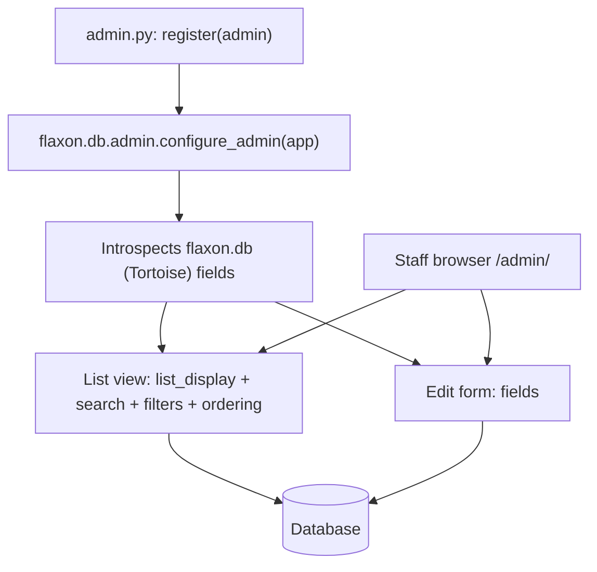
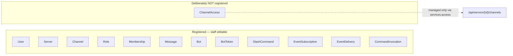

# Lesson 12 — Flaxon Admin: moderation without custom CRUD

> **Track position:** the product works. Now give staff a way to look inside it.

## Goal

Register the ORM models with Flaxon Admin so staff can search, filter, and edit
users, servers, channels, messages, and the whole bot platform — with **no
hand-written admin views**.

## System design





That second diagram is the interesting decision: **`ChannelAccess` is not an
admin model.** It is a pure authorization table; letting someone edit grants from
a dropdown bypasses the reasoning Lesson 6 built. Where you *withhold* admin is
a design choice, not an omission.

## Step 1 — Create `admin.py`

Imports at the top:

```python
"""Admin registrations for the Discord-clone example."""
from __future__ import annotations

from models import (
    Bot,
    BotMembership,
    BotToken,
    Channel,
    ChannelAccess,
    CommandInvocation,
    EventDelivery,
    EventSubscription,
    Membership,
    Message,
    Role,
    Server,
    SlashCommand,
    User,
)
```

Then a single `register(admin)` function. Each entry is metadata about how to
*present* a model — nothing about how to store it:

```python
def register(admin) -> None:
    admin.register(
        User,
        list_display=["id", "username", "display_name", "email", "is_active"],
        search_fields=["username", "email", "display_name"],
        list_filter=["is_active"],
        fields=["username", "display_name", "email", "is_active", "avatar_color"],
        ordering=["username"],
    )
    admin.register(
        Server,
        list_display=["id", "name", "owner_id", "invite_code"],
        search_fields=["name", "invite_code"],
        fields=["name", "owner_id", "invite_code", "icon_color"],
        ordering=["name"],
    )
    admin.register(
        Channel,
        list_display=["id", "name", "server_id", "is_private"],
        search_fields=["name"],
        list_filter=["is_private"],
        fields=["name", "server_id", "topic", "is_private", "position"],
        ordering=["server_id", "position"],
    )
    admin.register(
        Role,
        list_display=["id", "name", "server_id", "permissions"],
        search_fields=["name"],
        fields=["name", "server_id", "permissions", "color", "position"],
        ordering=["server_id", "position"],
    )
    admin.register(
        Membership,
        list_display=["id", "server_id", "user_id", "role_id"],
        search_fields=["user_id", "server_id"],
        fields=["server_id", "user_id", "role_id", "nickname"],
        ordering=["server_id", "user_id"],
    )
    admin.register(
        Message,
        list_display=["id", "channel_id", "author_id", "author_bot_id", "type", "created_at"],
        search_fields=["content"],
        list_filter=["type"],
        fields=["channel_id", "author_id", "author_bot_id", "content", "type"],
        ordering=["-created_at"],
    )
```

And the bot platform — this is where Admin pays for itself, because
`EventDelivery` and `CommandInvocation` are debugging surfaces:

```python
    admin.register(
        Bot,
        list_display=["id", "name", "owner_id", "is_enabled"],
        search_fields=["name"],
        list_filter=["is_enabled"],
        fields=["name", "owner_id", "description", "is_enabled"],
        ordering=["name"],
    )
    admin.register(
        BotToken,
        list_display=["id", "bot_id", "label", "token_prefix", "revoked_at"],
        search_fields=["label", "token_prefix"],
        list_filter=["revoked_at"],
        fields=["bot_id", "label", "token_prefix"],
        ordering=["-created_at"],
    )
    admin.register(
        SlashCommand,
        list_display=["id", "bot_id", "name", "is_enabled"],
        search_fields=["name"],
        list_filter=["is_enabled"],
        fields=["bot_id", "name", "description", "parameters", "is_enabled"],
        ordering=["bot_id", "name"],
    )
    admin.register(
        EventSubscription,
        list_display=["id", "bot_id", "event_type", "is_enabled"],
        search_fields=["event_type"],
        list_filter=["is_enabled"],
        fields=["bot_id", "event_type", "is_enabled"],
        ordering=["bot_id", "event_type"],
    )
    admin.register(
        EventDelivery,
        list_display=["id", "bot_id", "event_type", "status", "attempt_count"],
        search_fields=["event_type"],
        list_filter=["status"],
        fields=["bot_id", "event_type", "status", "attempt_count", "last_error"],
        ordering=["-created_at"],
    )
    admin.register(
        CommandInvocation,
        list_display=["id", "bot_id", "command_id", "status", "created_at"],
        search_fields=["result", "error"],
        list_filter=["status"],
        fields=["bot_id", "command_id", "server_id", "user_id", "status", "result", "error"],
        ordering=["-created_at"],
    )
    # ChannelAccess is intentionally NOT registered as an editable Admin model:
    # it is a pure authorization table and is managed through the API only.
```

Note what `BotToken` exposes: `token_prefix` and `revoked_at` — **never**
`token_hash`. Even in the staff UI, nothing that could authenticate is shown.

## Step 2 — Wire it into `app.py`

```python
from flaxon.db.admin import configure_admin

from admin import register as register_admin_models

    # -- Admin: staff moderation over the ORM tables -------------------------
    admin = configure_admin(app)
    register_admin_models(admin)
```

And the settings switches:

```python
ADMIN_ENABLED = True
ADMIN_STORE_BACKEND = "orm"
```

## Step 3 — Create a staff user

```bash
python management.py migrate
python management.py setup-admin
```

Then visit `http://127.0.0.1:8000/admin/`.

## Verify

| Scenario | Expected |
|---|---|
| `GET /admin/` | login page, then the model index |
| Search a user by email | matching rows |
| Filter messages by `type` | only that type |
| Open a `CommandInvocation` | shows `status`, `result`, `error` |
| Open a `BotToken` | `token_prefix` visible, no hash field editable |
| Look for `ChannelAccess` in the index | **absent** |

## Why this way

- **Admin is derived, not written.** Field definitions already exist in
  `models.py`; Admin introspects them. Adding a model to Admin is ~8 lines, and
  it can never drift from the schema.
- **Moderation needs breadth, not bespoke logic.** Staff answer "who said what,
  when" — a list view with search covers it. Bespoke permission logic stays in
  `services/`, where it is tested.
- **Authorization tables are excluded on purpose.** If a grant could be edited
  from a dropdown, the invariant from Lesson 6 ("a private channel is visible
  only because a grant row exists") becomes a matter of staff discipline instead
  of a property of the system.
- **`ordering=["-created_at"]` on audit tables** turns them into an ops timeline
  with no extra work.

## Next

[Lesson 13 — CMS announcements](13-cms.md).
