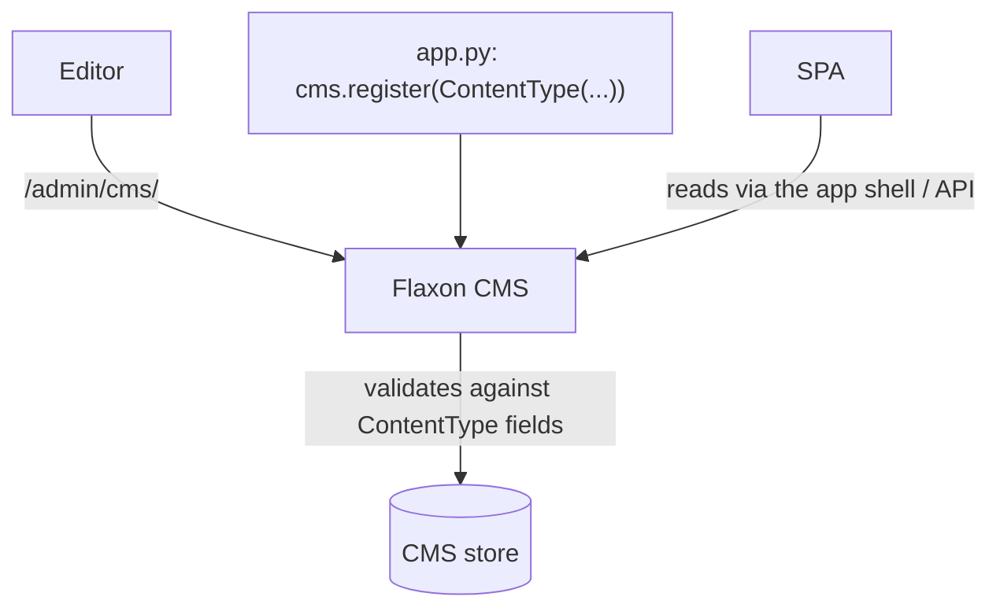
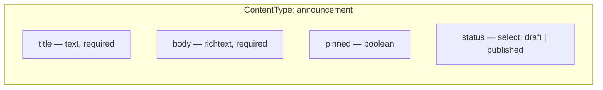

# Lesson 13 — CMS: an editorial layer beside the app data

> **Track position:** staff can moderate rows. Now give them somewhere to write
> prose that users actually read.

## Goal

Register one CMS content type — **announcement** — so release notes and server
news are authored in `/admin/cms/` and rendered in the SPA, entirely separate
from chat data.

## System design





The distinction that matters:

| | Chat data | CMS content |
|---|---|---|
| Authored by | users, at runtime | editors, ahead of time |
| Lives in | `dc_messages` (ORM) | CMS store |
| Shape | fixed (`Message`) | declared by a `ContentType` |
| Read by | paginated queries | list display + filters |

Two storage systems is not duplication — it is two different lifecycles. Chat is
append-only traffic; announcements are drafted, reviewed, and published.

## Step 1 — Register the content type

In `app.py`, the import and the registration:

```python
from flaxon.admin.cms import CMSField, ContentType

    # -- CMS: an editorial "announcements" channel ---------------------------
    cms = app.cms
    cms.register(
        ContentType(
            name="announcement",
            label="Announcement",
            label_plural="Announcements",
            fields=[
                CMSField("title", "Title", required=True),
                CMSField("body", "Body", type="richtext", required=True),
                CMSField("pinned", "Pin to top", type="boolean"),
                CMSField(
                    "status",
                    "Status",
                    type="select",
                    choices=["draft", "published"],
                ),
            ],
            list_display=["title", "pinned", "status", "updated_at"],
            list_filter=["status", "pinned"],
            search_fields=["title", "body"],
        )
    )
```

Enable it in `settings.py`:

```python
CMS_ENABLED = True
```

## Step 2 — Seed one announcement (idempotently)

In `seed.py`:

```python
def seed_cms(app) -> int:
    cms = getattr(app, "cms", None)
    if cms is None:
        return 0
    content_type = cms.content_types.get("announcement")
    if content_type is None:
        return 0
    existing = {item.get("title") for item in content_type.items.values()}
    if "Welcome to Flaxon HQ" in existing:
        return 0                      # already seeded; never duplicate
    content_type.create(
        {
            "title": "Welcome to Flaxon HQ",
            "body": "<p>This is a demo server seeded by <code>seed.py</code>. "
            "Try the Greeter bot with <code>/ping</code> or mention it by name.</p>",
            "pinned": True,
            "status": "published",
        }
    )
    cms._save(content_type)
    return 1
```

The `existing` set is the same idea as the ORM seeding in Lesson 17: **a seed
script must be safe to run twice.**

## Step 3 — Show it in the SPA shell

Pass the CMS URL into the compiled template so the shell can link to the
editorial surface:

```python
    @app.get("/")
    @app.get("/<path:spa_path>")
    async def spa(request: Request, spa_path: str = "") -> object:
        if spa_path.startswith(("api/", "admin", "_flaxon", "static")):
            from flaxon.exceptions import NotFound

            raise NotFound("Not found")
        return await request.compile(
            "app.html",
            {"title": "Discord Clone", "admin_url": "/admin/", "cms_url": "/admin/cms/"},
        )
```

## Verify

| Scenario | Expected |
|---|---|
| `GET /admin/cms/` | "Announcements" appears in the content-type list |
| Create an announcement, `status=draft` | saved, not shown to users |
| Flip to `published` | appears in the published list |
| Filter by `pinned` | only pinned items |
| Run `python seed.py` twice | `CMS items created: 1`, then `0` |

## Why this way

- **A `ContentType` is a schema you can change without a migration.** Editorial
  fields evolve with the newsroom, not with the chat schema.
- **`status` as a select, not a delete.** Un-publishing is reversible and
  keeps the history of what was said.
- **Richtext is editor-authored only.** Users never supply HTML; only the CMS
  body does. Chat content stays plain text, which is why no sanitiser is needed
  there.
- **Separate store, separate lifecycle, separate permissions** — an editor who
  can publish an announcement cannot edit a message.

## Next

[Lesson 14 — The SPA shell](14-spa.md).
