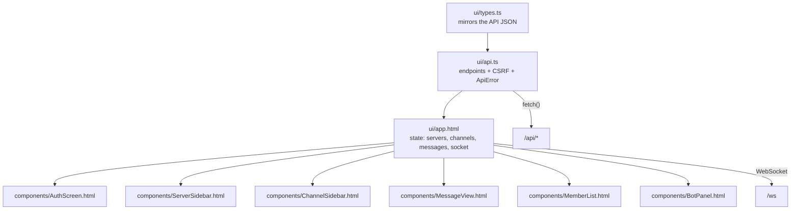
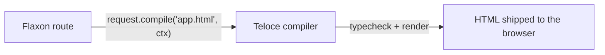

# Lesson 14 — The SPA: types, API client, and app shell

> **Track position:** the backend is complete. Now build the browser half with
> Teloce — server-rendered, compiled from `ui/`, no separate build step.

## Goal

Three files that define the client contract: `ui/types.ts` (the JSON shapes),
`ui/api.ts` (every endpoint in one place, CSRF included), and `ui/app.html` (the
shell that owns application state).

## System design





The shell owns **all** state; components are presentational and communicate with
props down / events up. There is no client-side store to desync.

## Step 1 — `ui/types.ts`

Every interface here mirrors a `to_public()` method on a model. If they drift,
`python management.py typecheck` (Lesson 15) tells you.

```ts
// Shared types for the Discord-clone SPA.
// These mirror the JSON shapes returned by the /api routes in modules/.

export interface User {
  id: number;
  username: string;
  display_name: string;
  avatar_color: string;
}

export interface ServerPublic {
  id: number;
  name: string;
  icon_color: string;
  owner_id: number;
  invite_code: string;
}

export interface ChannelPublic {
  id: number;
  server_id: number;
  name: string;
  topic: string;
  is_private: boolean;
  position: number;
}

export interface MemberView {
  user: User;
  nickname: string;
  role: string;
  role_color: string;
}

export interface RoleView {
  id: number;
  name: string;
  color: string;
  permissions: number;
  permission_names: string[];
}

export interface MessagePublic {
  id: number;
  channel_id: number;
  author_id: number | null;
  author_bot_id: number | null;
  content: string;
  type: number;
  created_at: string | null;
  edited_at: string | null;
}

export interface BotPublic {
  id: number;
  owner_id: number;
  name: string;
  description: string;
  is_enabled: boolean;
}

export interface BotTokenView {
  id: number;
  label: string;
  prefix: string;
  revoked: boolean;
  last_used_at: string | null;
}
```

## Step 2 — `ui/api.ts`

The header — note the `import type` block, which is what keeps the client and the
server honest:

```ts
// API client for the Discord-clone example.
import type {
  User,
  ServerPublic,
  ChannelPublic,
  MemberView,
  RoleView,
  MessagePublic,
  BotPublic,
  BotTokenView,
} from "./types.ts";

let csrfToken: string | null = null;

export function setCsrf(token: string): void {
  csrfToken = token;
}

export async function fetchCsrf(): Promise<string> {
  const res = await fetch("/api/auth/csrf-token");
  if (!res.ok) throw new Error("Could not fetch CSRF token");
  const data = await res.json();
  csrfToken = data.token;
  return data.token;
}
```

One request function carries the CSRF header, so no call site can forget it:

```ts
export class ApiError extends Error {
  status: number;
  constructor(status: number, message: string) {
    super(message);
    this.status = status;
    this.name = "ApiError";
  }
}

async function request<T>(method: string, path: string, body?: unknown): Promise<T> {
  const headers: Record<string, string> = { "Content-Type": "application/json" };
  if (body !== undefined && csrfToken) headers["x-csrf-token"] = csrfToken;
  const res = await fetch(path, {
    method,
    headers,
    body: body !== undefined ? JSON.stringify(body) : undefined,
  });
  const text = await res.text();
  const data = text ? JSON.parse(text) : null;
  if (!res.ok) {
    const message = (data && (data.detail || data.message)) || `Request failed (${res.status})`;
    throw new ApiError(res.status, message);
  }
  return data as T;
}
```

Then the grouped endpoints. **Collection routes carry a trailing slash** —
Flaxon mounts module roots that way, and without it you hit the SPA catch-all
and get HTML back:

```ts
// NOTE: module root routes mount with a trailing slash, so collection endpoints
// use "/api/servers/" / "/api/bots/".
export const servers = {
  list: () => request<{ items: ServerPublic[] }>("GET", "/api/servers/"),
  create: (name: string) => request<{ server: ServerPublic }>("POST", "/api/servers/", { name }),
  get: (id: number) =>
    request<{ server: ServerPublic; permissions: string[] }>("GET", `/api/servers/${id}`),
  join: (invite_code: string) =>
    request<{ server: ServerPublic }>("POST", "/api/servers/join", { invite_code }),
  members: (id: number) => request<{ items: MemberView[] }>("GET", `/api/servers/${id}/members`),
  channels: (id: number) =>
    request<{ items: ChannelPublic[] }>("GET", `/api/servers/${id}/channels`),
};

export const messages = {
  history: (channelId: number, before?: number, limit?: number) => {
    const q: Record<string, string> = {};
    if (before) q.before = String(before);
    if (limit) q.limit = String(limit);
    const qs = new URLSearchParams(q).toString();
    return request<{ items: MessagePublic[] }>("GET", `/api/channels/${channelId}/messages?${qs}`);
  },
  send: (channelId: number, content: string) =>
    request<{ message: MessagePublic; bot_messages: MessagePublic[] }>(
      "POST",
      `/api/channels/${channelId}/messages`,
      { content },
    ),
};

export const bots = {
  list: () => request<{ items: BotPublic[] }>("GET", "/api/bots/"),
  create: (name: string, description?: string) =>
    request<{ bot: BotPublic; token: string }>("POST", "/api/bots/", { name, description }),
  invoke: (id: number, payload: { channel_id: number; command: string; args?: string[] }) =>
    request<{ invocation: Record<string, unknown>; messages: MessagePublic[] }>(
      "POST",
      `/api/bots/${id}/invoke`,
      payload,
    ),
};
```

`messages.send` returns **both** the user's message and any bot replies —
Lesson 9's `bot_messages`. The client renders them identically.

## Step 3 — `ui/app.html`, the shell

Template first — the whole layout is a set of components with explicit
props/events:

```html
<template>
  <AuthScreen v-if="!currentUser" @authenticated="onAuthenticated" />

  <div v-else class="app">
    <ServerSidebar
      :servers="servers"
      :current-server-id="currentServerId"
      @select="selectServer"
      @created="onServerCreated"
      @joined="onServerJoined"
    />

    <ChannelSidebar
      v-if="currentServer"
      :server-id="currentServer.id"
      :server-name="currentServer.name"
      :channels="channels"
      :current-channel-id="currentChannelId"
      @select="selectChannel"
      @created="onChannelCreated"
    />

    <MessageView
      v-if="currentChannel"
      :messages="messages"
      :current-user="currentUser"
      :channel-name="currentChannel.name"
      :channel-topic="currentChannel.topic"
      :typing-names="typingNames"
      :name-by-id="nameById"
      @send="sendMessage"
      @delete="deleteMessage"
      @typing="notifyTyping"
      @open-bots="botPanelOpen = true"
    />

    <MemberList v-if="members.length" :members="members" :online-ids="onlineIds" />
    <BotPanel v-if="botPanelOpen" :server-id="currentServerId" :channel-id="currentChannelId"
              @close="botPanelOpen = false" />
  </div>
</template>
```

Script header — every component and every API group is imported once, here:

```ts
<script lang="ts">
import AuthScreen from "./components/AuthScreen.html";
import ServerSidebar from "./components/ServerSidebar.html";
import ChannelSidebar from "./components/ChannelSidebar.html";
import MessageView from "./components/MessageView.html";
import MemberList from "./components/MemberList.html";
import BotPanel from "./components/BotPanel.html";

import { auth, servers as serverApi, messages as msgApi, bots as botApi, fetchCsrf } from "./api.ts";
import type {
  User, ServerPublic, ChannelPublic, MemberView, MessagePublic, BotPublic,
} from "./types.ts";

export default {
  components: { AuthScreen, ServerSidebar, ChannelSidebar, MessageView, MemberList, BotPanel },
  data() {
    return {
      currentUser: null as User | null,
      servers: [] as ServerPublic[],
      currentServerId: null as number | null,
      channels: [] as ChannelPublic[],
      currentChannelId: null as number | null,
      members: [] as MemberView[],
      messages: [] as MessagePublic[],
      nameById: {} as Record<number, { name: string; color: string }>,
      onlineIds: [] as number[],
      typingNames: [] as string[],
      botPanelOpen: false,
      bots: [] as BotPublic[],
      socket: null as WebSocket | null,
      reconnectTimer: null as number | null,
      lastTypingAt: 0,
    };
  },
  computed: {
    currentServer(): ServerPublic | null {
      return this.servers.find((s) => s.id === this.currentServerId) || null;
    },
    currentChannel(): ChannelPublic | null {
      return this.channels.find((c) => c.id === this.currentChannelId) || null;
    },
  },
```

State loading, in order: **authenticate → fetch CSRF → connect socket → load
data**:

```ts
    async onAuthenticated(user: User) {
      this.currentUser = user;
      await fetchCsrf();            // required before ANY mutation
      this.connectWs();
      await this.loadBots();
      await this.loadServers();
    },
    async selectServer(id: number) {
      this.currentServerId = id;
      const [chRes, memRes] = await Promise.all([
        serverApi.channels(id),
        serverApi.members(id),
      ]);
      this.channels = (chRes as { items: ChannelPublic[] }).items;
      this.members = (memRes as { items: MemberView[] }).items;
      this.rebuildNameMap();
      if (this.channels.length) {
        await this.selectChannel(this.channels[0].id);
      } else {
        this.currentChannelId = null;
        this.messages = [];
      }
    },
    async selectChannel(id: number) {
      this.currentChannelId = id;
      this.messages = [];
      const res = await msgApi.history(id, undefined, 100);
      this.messages = (res as { items: MessagePublic[] }).items;
      this.subscribeChannel();       // attach the socket to the new channel
    },
```

`nameById` is built from members *and* bots, so a bot reply renders with a name
and colour using the same code path as a human message:

```ts
    rebuildNameMap() {
      const map: Record<number, { name: string; color: string }> = {};
      for (const m of this.members) {
        map[m.user.id] = { name: m.user.display_name, color: m.user.avatar_color };
      }
      for (const b of this.bots) {
        map[b.id] = { name: b.name, color: "#5865f2" };
      }
      this.nameById = map;
    },
```

## Step 4 — Register Teloce and the catch-all

In `app.py`, **before** the `is_management` guard so `typecheck`/`build` still
work:

```python
    app.use_teloce(
        project_root=settings.root,
        ui_dir="ui",
        title="Discord Clone — System Design Course",
        description="A teaching Discord clone built on Flaxon + Teloce.",
    )
```

The catch-all goes **last**, and refuses to serve HTML for API/asset paths:

```python
    @app.get("/")
    @app.get("/<path:spa_path>")
    async def spa(request: Request, spa_path: str = "") -> object:
        if spa_path.startswith(("api/", "admin", "_flaxon", "static")):
            from flaxon.exceptions import NotFound

            raise NotFound("Not found")
        return await request.compile("app.html", {"title": "Discord Clone"})
```

## Verify

| Scenario | Expected |
|---|---|
| `GET /` | the compiled SPA shell |
| `GET /api/nope` | **404 JSON**, not the SPA HTML |
| `GET /admin/` | Admin, not the SPA |
| Register in the UI | chat layout appears |
| Open the browser console on load | no failed `/api/` request |

## Why this way

- **Types mirror `to_public()`.** The API contract is one place per side, and the
  typechecker keeps them aligned.
- **CSRF is fetched once and attached centrally.** A component cannot accidentally
  issue an unauthenticated mutation.
- **The shell owns state.** No client store means no cache-invalidation bugs;
  the server is the only source of truth.
- **The catch-all is guarded.** A missing API route returns 404 JSON instead of
  HTML, which turns silent client-side `JSON.parse` failures into obvious ones.

## Next

[Lesson 15 — Wiring the UI: components and the WebSocket layer](15-wiring-ui.md).
