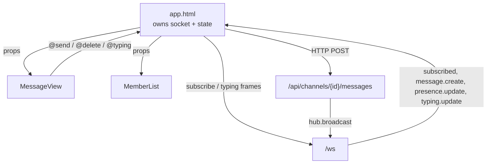
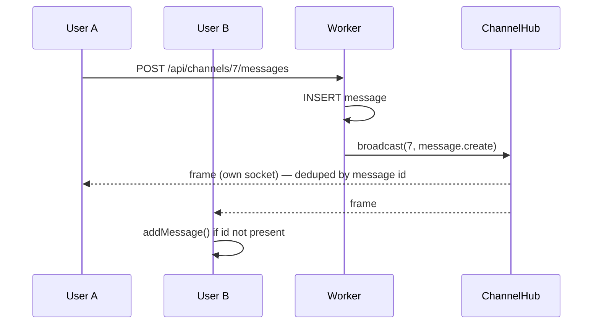

# Lesson 15 — Wiring the UI: components and the WebSocket layer

> **Track position:** the shell renders and loads data. Now make it live, and
> type-check the whole SPA.

## Goal

Six presentational components, a reconnecting WebSocket client, and a clean
`python management.py typecheck`.

## System design





That last line is the important one: **the sender also receives its own event
back.** The client must dedupe by `id`, or every message renders twice.

## Step 1 — `components/AuthScreen.html`

```html
<template>
  <div class="auth">
    <div class="auth-card">
      <h1>Discord Clone</h1>
      <div class="tabs">
        <button :class="{ active: mode === 'login' }" @click="mode = 'login'">Log in</button>
        <button :class="{ active: mode === 'register' }" @click="mode = 'register'">Register</button>
      </div>
      <form @submit.prevent="submit">
        <label v-if="mode === 'register'">
          Email
          <input v-model="email" type="email" autocomplete="email" required>
        </label>
        <label>Username <input v-model="username" type="text" required></label>
        <label>Password <input v-model="password" type="password" required></label>
        <p v-if="error" class="error">{{ error }}</p>
        <button type="submit" :disabled="busy">{{ busy ? "Working…" : "Go" }}</button>
      </form>
    </div>
  </div>
</template>

<script lang="ts">
import { auth } from "../api.ts";
import type { User } from "../types.ts";

export default {
  data() {
    return { mode: "login" as "login" | "register", username: "", password: "", email: "", busy: false, error: "" };
  },
  methods: {
    async submit() {
      this.busy = true;
      this.error = "";
      try {
        const res = this.mode === "login"
          ? await auth.login(this.username, this.password)
          : await auth.register(this.username, this.email, this.password);
        this.$emit("authenticated", (res as { user: User }).user);
      } catch (e) {
        this.error = (e as Error).message;
      } finally {
        this.busy = false;
      }
    },
  },
};
</script>
```

## Step 2 — `components/MessageView.html`

Header and the two details that matter — dedupe and the scroll ref:

```html
<script lang="ts">
import type { MessagePublic, User } from "../types.ts";

export default {
  props: ["messages", "currentUser", "channelName", "channelTopic", "typingNames", "nameById"],
  data() {
    return { draft: "" };
  },
  updated() {
    // teloce's RuntimeContext types only expose $emit/$attrs; the template ref
    // is reached through a narrow cast so the scroll-to-bottom stays typed-safe.
    const refs = (this as unknown as { $refs: Record<string, HTMLElement> }).$refs;
    const el = refs["scroller"];
    if (el) el.scrollTop = el.scrollHeight;
  },
  methods: {
    nameOf(msg: MessagePublic): { name: string; color: string } {
      const id = msg.author_id ?? msg.author_bot_id;
      const entry = id != null
        ? (this.nameById as Record<number, { name: string; color: string }>)[id]
        : undefined;
      if (entry) return entry;
      return msg.author_bot_id != null
        ? { name: "Bot", color: "#5865f2" }
        : { name: "Unknown", color: "#80848e" };
    },
    send() {
      const content = this.draft.trim();
      if (!content) return;
      this.$emit("send", content);
      this.draft = "";
    },
  },
};
</script>
```

In the template, `nameOf(...)` returns an **object**, so take `.name` for the
initial and `.color` for the avatar — passing the object straight into
`{{ initial(...) }}` renders `[object Object]`:

```html
<span class="avatar" :style="avatarStyle(msg)">{{ initial(nameOf(msg).name) }}</span>
<span class="author" :style="{ color: nameOf(msg).color }">{{ nameOf(msg).name }}</span>
```

## Step 3 — `components/ServerSidebar.html`, `ChannelSidebar.html`, `MemberList.html`, `BotPanel.html`

These follow one rule: **props in, events out.** They call the API client
directly for their own mutations, then emit the result so the shell updates its
state.

```html
<script lang="ts">
import { servers } from "../api.ts";
import type { ServerPublic } from "../types.ts";

export default {
  props: ["servers", "currentServerId"],
  data() { return { creating: false, newName: "", invite: "", error: "" }; },
  methods: {
    async create() {
      this.error = "";
      try {
        const res = await servers.create(this.newName.trim());
        this.$emit("created", (res as { server: ServerPublic }).server);
      } catch (e) {
        this.error = (e as Error).message;
      }
    },
  },
};
</script>
```

`BotPanel.html` is the UI face of Lessons 8–9: create a bot (token shown once),
add it to the server, subscribe it to `message.create`, register `/ping`, invoke
it, and revoke tokens. Every button is one `bots.*` call from `api.ts`.

## Step 4 — The WebSocket layer in `app.html`

```ts
    connectWs() {
      const proto = location.protocol === "https:" ? "wss" : "ws";
      const socket = new WebSocket(`${proto}://${location.host}/ws`);
      this.socket = socket;
      socket.onmessage = (event) => this.handleWs(event);
      socket.onclose = () => {
        this.socket = null;
        if (this.reconnectTimer === null && this.currentUser) {
          this.reconnectTimer = window.setTimeout(() => this.connectWs(), 2000);
        }
      };
      socket.onopen = () => {
        if (this.reconnectTimer !== null) {
          window.clearTimeout(this.reconnectTimer);
          this.reconnectTimer = null;
        }
        this.subscribeChannel();          // re-subscribe after a reconnect
      };
    },
    subscribeChannel() {
      if (this.socket && this.socket.readyState === WebSocket.OPEN && this.currentChannelId !== null) {
        this.socket.send(JSON.stringify({ type: "subscribe", channel_id: this.currentChannelId }));
      }
    },
```

Two behaviours worth copying: **reconnect with a 2s timer**, and **re-subscribe
on `onopen`** — a socket that reconnects without re-subscribing looks connected
and receives nothing.

Handling frames — note the dedupe by `id`:

```ts
    handleWs(event: MessageEvent) {
      let payload: any;
      try {
        payload = JSON.parse(event.data);
      } catch {
        return;
      }
      switch (payload.type) {
        case "subscribed":
          this.onlineIds = payload.presence || [];
          this.updateTyping(payload.typing || []);
          break;
        case "message.create":
          if (payload.message.channel_id === this.currentChannelId) {
            this.addMessage(payload.message);
          }
          break;
        case "message.delete":
          this.messages = this.messages.filter((m) => m.id !== payload.message_id);
          break;
        case "presence.update":
          if (payload.channel_id === this.currentChannelId) {
            this.onlineIds = payload.user_ids || [];
          }
          break;
        case "typing.update":
          if (payload.channel_id === this.currentChannelId) {
            this.updateTyping(payload.user_ids || []);
          }
          break;
      }
    },
    addMessage(msg: MessagePublic) {
      if (this.messages.some((m) => m.id === msg.id)) return;   // own echo
      this.messages.push(msg);
    },
```

Typing notifications are throttled client-side (one per 3s) so typing does not
become a broadcast storm:

```ts
    notifyTyping() {
      const now = Date.now();
      if (now - this.lastTypingAt < 3000) return;
      this.lastTypingAt = now;
      if (this.socket && this.socket.readyState === WebSocket.OPEN && this.currentChannelId !== null) {
        this.socket.send(JSON.stringify({ type: "typing", channel_id: this.currentChannelId }));
      }
    },
```

## Step 5 — Type-check the SPA

```bash
python management.py typecheck
```

Expected output:

```
No type errors found
```

This compiles every `.html` component and `.ts` file under `ui/`. Two real bugs
surfaced here during development, both worth remembering:

1. `{{ initial(nameOf(msg)) }}` — passing an object where a string was expected.
   It renders `[object Object]` at runtime and type-checks as an error.
2. `this.$refs.scroller as HTMLElement` — Teloce's `RuntimeContext` types expose
   `$emit` and `$attrs` but not `$refs`, so the ref needs an explicit cast.

## Verify

| Scenario | Expected |
|---|---|
| `python management.py typecheck` | `No type errors found` |
| Two browser tabs in one channel | message appears in both |
| Sender's own tab | message appears **once** |
| Close the server, restart | client reconnects and re-subscribes |
| Type in the composer | "typing…" appears in the other tab within 3s |
| Stop typing for 8s | indicator disappears (hub TTL sweep) |
| Open a private channel as a non-granted member | `forbidden` frame, no messages |

## Why this way

- **Components are presentational.** All state in the shell means one source of
  truth and trivially reproducible bugs.
- **Reconnect then re-subscribe.** The subscription is server-side state attached
  to a socket; a new socket starts with none.
- **Dedupe by message id, always.** At-least-once delivery plus an optimistic
  local insert guarantees duplicates unless you check.
- **Typecheck is part of the loop**, not a CI afterthought — it caught two
  genuine runtime bugs here.

## Next

[Lesson 16 — Security review](16-security.md).
