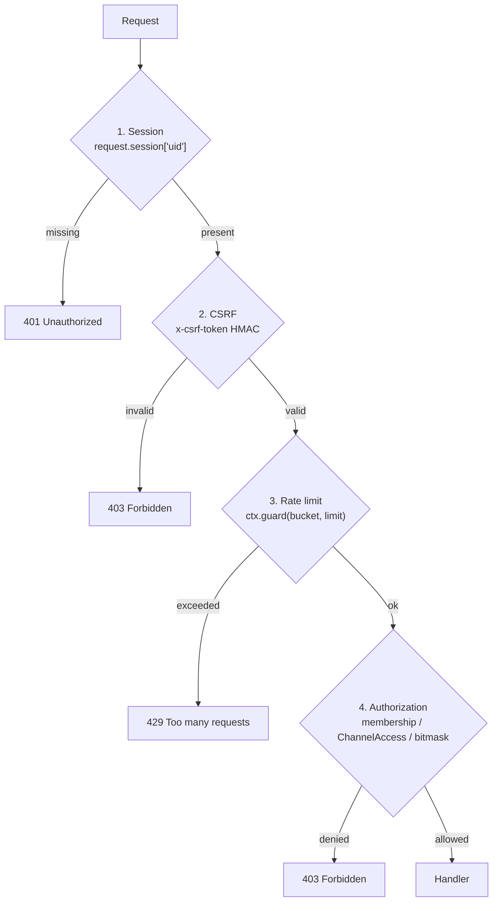
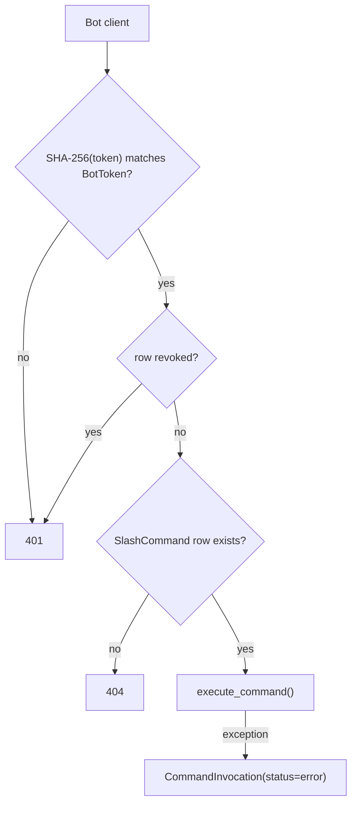

# Lesson 16 — Security review: audit what you actually built

> **Track position:** the app is feature-complete. Now attack it, on purpose.

## Goal

Walk every trust boundary in the system and write a test for each promise. The
output of this lesson is `tests/test_security.py` — a set of assertions that
would fail loudly if a future change quietly removed a control.

## System design

Every request crosses four gates, in this order:



Bots take a different path — **token authentication instead of CSRF**:



A bot client is not a browser, so it cannot be tricked into a cross-site
request — CSRF would be meaningless there. That asymmetry is deliberate, and
`modules/_common.py` says so in a comment.

## Step 1 — Passwords: argon2, and no user-enumeration timing

`services/auth.py`:

```python
"""Authentication and session helpers."""
from __future__ import annotations

from flaxon.exceptions import Unauthorized
from flaxon.security.password import hash_password, verify_password
from models import User

SESSION_KEY = "uid"
MIN_PASSWORD_LENGTH = 8


async def authenticate(username: str, password: str) -> User | None:
    user = await User.get_or_none(username=username)
    # Constant-ish path: still hash even when the user is missing so timing
    # does not trivially reveal which usernames exist.
    if user is None or not user.password_hash:
        verify_password(password or "", "$argon2id$v=19$m=65536,t=3,p=4$0000...$0000...")
        return None
    if not verify_password(password or "", user.password_hash):
        return None
    if not user.is_active:
        return None
    return user
```

The dummy hash on the "no such user" branch is the point: without it, a missing
user returns in microseconds while a real one costs an argon2 verification — a
free username oracle.

## Step 2 — CSRF on every browser mutation

`modules/_common.py`:

```python
def require_csrf(ctx, request) -> None:
    """Reject state-changing requests without a valid CSRF token.

    Bot endpoints authenticate with a bearer token instead and are exempt: a bot
    client is not a browser, so it cannot be tricked into a cross-site request.
    """
    ctx.csrf.validate_request(request)
```

And in `context.py`, the CSRF object is a Flaxon primitive, not a hand-rolled
token:

```python
from flaxon.security.csrf import CSRF
from flaxon.security.rate_limit import RateLimiter


class AppContext:
    def __init__(self, *, secret_key: str, broadcaster: Broadcaster | None = None) -> None:
        self.secret_key = secret_key
        self.rate_limit_enabled = os.environ.get("RATE_LIMIT_ENABLED", "true").lower() != "false"
        self.csrf = CSRF(secret_key=secret_key)
```

## Step 3 — Rate limiting, with a test escape hatch

```python
    def _limiter(self, bucket: str, limit: tuple[int, int]) -> RateLimiter:
        key = f"{bucket}:{limit[0]}:{limit[1]}"
        limiter = self._limiters.get(key)
        if limiter is None:
            limiter = RateLimiter(
                requests=limit[0],
                window_seconds=limit[1],
                key_func=lambda scope: f"{bucket}:{_client_ip(scope)}",
            )
            self._limiters[key] = limiter
        return limiter

    async def guard(self, request, bucket: str, limit: tuple[int, int] | None) -> None:
        if limit is None or not self.rate_limit_enabled:
            return
        if not await self._limiter(bucket, limit).check(request.scope or {}):
            raise TooManyRequests("Too many requests — slow down and retry later")
```

`RATE_LIMIT_ENABLED=false` exists **only** because every test shares one client
IP. The application code path is unchanged — the tests never take a different
branch in the route handlers.

> Be honest about the limitation: this limiter is **process-local**. With four
> workers, the effective limit is 4×. Cross-worker enforcement needs Redis, which
> is the same reason `REDIS_URL` appears in Lesson 11.

## Step 4 — Isolation, enforced at the query

`modules/_common.py`:

```python
async def authorize_channel(user_id: int, channel: Channel) -> Channel:
    """A user reaches a channel only through server membership.

    Private channels additionally require an explicit ``ChannelAccess`` grant;
    without one even a server member is refused.
    """
    if not await is_member(user_id, channel.server_id):
        raise Forbidden("You are not a member of this server")
    if channel.is_private and not await ChannelAccess.exists(
        user_id=user_id, channel_id=channel.id
    ):
        raise Forbidden("This channel is private")
    return channel
```

## Step 5 — `tests/test_security.py`

```python
"""Security controls: CSRF enforcement, authentication gates, isolation."""
from __future__ import annotations


def _authed_owner(make_session):
    c = make_session()
    c.register("owner", "owner@example.com", "password123")
    c.fetch_csrf()          # primes a valid token; mutation tests tamper with it
    return c


def test_valid_csrf_allows_mutation(make_session):
    c = _authed_owner(make_session)
    assert c.post("/api/servers/", json_data={"name": "Guild"}).status_code == 200


def test_invalid_csrf_is_rejected(make_session):
    c = _authed_owner(make_session)
    c.csrf = "not-a-real-token"
    assert c.post("/api/servers/", json_data={"name": "Guild"}).status_code == 403


def test_unauthenticated_mutation_requires_login(make_session):
    c = make_session()      # no session cookie at all
    assert c.post("/api/servers/", json_data={"name": "Guild"}).status_code == 401


def test_private_channel_hidden_from_unauthorized_member(make_session):
    owner = _authed_owner(make_session)
    sid = owner.post("/api/servers/", json_data={"name": "Guild"}).json()["server"]["id"]
    invite = owner.get(f"/api/servers/{sid}").json()["server"]["invite_code"]

    bob = make_session()
    bob.register("bob", "bob@example.com", "password123")
    bob.fetch_csrf()
    assert bob.post("/api/servers/join", json_data={"invite_code": invite}).status_code == 200

    priv = owner.post(
        f"/api/servers/{sid}/channels", json_data={"name": "secret", "is_private": True}
    ).json()["channel"]
    # bob is a member but holds no ChannelAccess grant -> 403 at the API layer.
    assert bob.get(f"/api/channels/{priv['id']}/messages").status_code == 403
    assert owner.get(f"/api/channels/{priv['id']}/messages").status_code == 200
```

The last test is the one that matters most: **bob is a member**, so a
membership-only check would let him through. Only the `ChannelAccess` grant
refuses him.

## The audit table

| Threat | Control | Where |
|---|---|---|
| Password disclosure | argon2 hash, never stored plaintext | `services/auth.py` |
| Username enumeration | dummy verify on the miss path | `services/auth.py` |
| Cross-site mutation | HMAC CSRF token, 1h lifetime | `require_csrf` |
| Credential stuffing / spam | per-IP rate buckets | `ctx.guard` |
| Private-channel leakage | `ChannelAccess` row required in the query | `authorize_channel` |
| Privilege escalation | permission bitmask resolved server-side | `services/access.py` |
| Bot token disclosure | SHA-256 hash only; plaintext shown once | `services/tokens.py` |
| Bot token misuse | owner-only revoke; per-bot rows | `modules/bots.py` |
| Arbitrary code execution | handlers are functions you ship; no `eval` | `services/bots.py` |
| WebSocket cross-channel read | re-authorised on every subscribe | `modules/realtime.py` |
| Secret leakage via repo | `.env` only, gitignored | `settings.py` |

## Verify

```bash
python3.11 -m pytest tests/test_security.py -p no:asyncio -o addopts="" -q
```

| Test | Promise |
|---|---|
| `test_valid_csrf_allows_mutation` | the happy path still works |
| `test_invalid_csrf_is_rejected` | forged token → 403 |
| `test_unauthenticated_mutation_requires_login` | no session → 401 |
| `test_private_channel_hidden_from_unauthorized_member` | isolation is server-side |
| `test_token_is_hashed_not_stored_plaintext` (Lesson 8) | DB holds only a hash |

## Why this way

- **The order of the gates is the security model.** Rate limiting before
  authorization would let an anonymous caller enumerate what exists via 403s.
- **Exemptions are written down.** Bots skip CSRF for a stated reason, not
  because someone forgot.
- **Test-only env flags, not test-only code paths.** `RATE_LIMIT_ENABLED` changes
  a boolean, not the route logic, so the tested code is the shipped code.
- **Isolation lives in the query.** If someone adds a new endpoint tomorrow, they
  inherit the guarantee instead of re-implementing it.

## Next

[Lesson 17 — Seed and run](17-seed-and-run.md).
