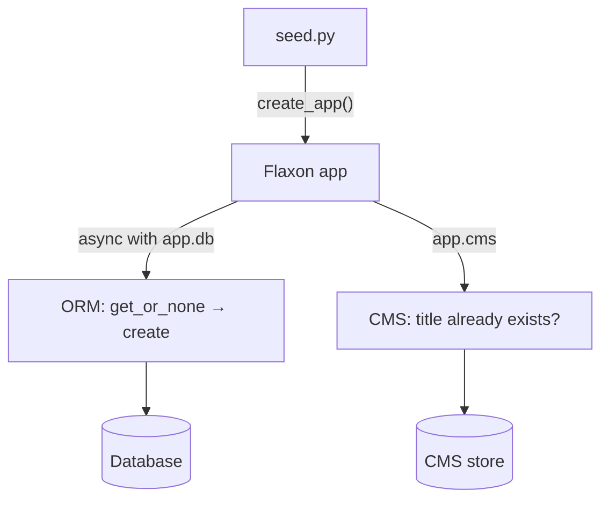
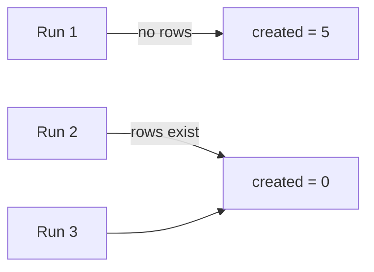

# Lesson 17 — Seed it and run it

> **Track position:** everything is built and tested. Now make it demoable in
> one command — and make that command safe to run twice.

## Goal

An idempotent `seed.py` that creates a demo server, users, channels, a role, and
a working bot; plus the exact run sequence for a fresh clone.

## System design





Every branch is a `get_or_none` guard, not a counter. A seed script that
duplicates on the second run is a script nobody dares to run.

## Step 1 — `seed.py`

Imports first:

```python
"""Load demo data for the Discord-clone course project, after `management.py migrate`."""
from __future__ import annotations

import asyncio

from app import create_app
from models import (
    Bot,
    BotMembership,
    Channel,
    EventSubscription,
    Membership,
    Role,
    Server,
    SlashCommand,
    User,
)
from services.auth import register_user
from services.tokens import issue_token

DEMO_USERNAME = "demo"
DEMO_PASSWORD = "password123"
DEMO_EMAIL = "demo@example.test"
SERVER_NAME = "Flaxon HQ"
BOT_NAME = "Greeter"
CHANNELS = ["general", "random", ("staff", True)]   # (name, is_private)
ROLE_PERMISSIONS = 8                                 # MANAGE_CHANNELS
```

The ORM seed:

```python
async def seed_orm() -> int:
    created = 0

    owner = await User.get_or_none(username=DEMO_USERNAME)
    if owner is None:
        owner = await register_user(DEMO_USERNAME, DEMO_EMAIL, DEMO_PASSWORD)
        created += 1

    alice = await User.get_or_none(username="alice")
    if alice is None:
        alice = await register_user("alice", "alice@example.test", DEMO_PASSWORD)
        created += 1

    server = await Server.get_or_none(name=SERVER_NAME, owner_id=owner.id)
    if server is None:
        server = await Server.create(name=SERVER_NAME, owner=owner, invite_code="flaxonhq")
        await Membership.create(server=server, user=owner)
        await Membership.create(server=server, user=alice)
        for index, spec in enumerate(CHANNELS):
            name, is_private = spec if isinstance(spec, tuple) else (spec, False)
            channel = await Channel.create(
                server=server, name=name, is_private=is_private, position=index
            )
            if is_private:
                # The owner can always see the private channel they seeded.
                from models import ChannelAccess

                await ChannelAccess.create(channel=channel, user=owner, granted_by=owner)
        role = await Role.create(
            server=server, name="Moderator", permissions=ROLE_PERMISSIONS, color="#5865f2"
        )
        await Membership.filter(server_id=server.id, user_id=alice.id).update(role_id=role.id)
        created += 1

    bot = await Bot.get_or_none(name=BOT_NAME, owner_id=owner.id)
    if bot is None:
        bot = await Bot.create(owner=owner, name=BOT_NAME, description="Example course bot")
        await BotMembership.create(server=server, bot=bot)
        await EventSubscription.create(bot=bot, event_type="message.create")
        await SlashCommand.create(bot=bot, name="ping", description="Reply with pong!")
        raw, _ = await issue_token(bot, label="seed")
        print(f"Bot '{BOT_NAME}' one-time token: {raw}")   # shown once, on purpose
        created += 1

    return created
```

Note the private channel: it also creates the owner's `ChannelAccess` grant.
Without it the seeded `staff` channel would be created and immediately
invisible — Lesson 6's rule applies to seeds too.

The entry point binds the ORM context explicitly:

```python
async def main() -> None:
    app = create_app()
    async with app.db:
        created = await seed_orm()
    written = seed_cms(app)
    print(f"ORM rows created: {created}")
    print(f"CMS items created: {written}")


if __name__ == "__main__":
    asyncio.run(main())
```

## Step 2 — The run sequence

```bash
cd examples/discord_clone

# 1. create the schema
python management.py migrate

# 2. create a staff login for /admin/
python management.py setup-admin

# 3. optional demo data
python seed.py
# -> Bot 'Greeter' one-time token: <raw>
# -> ORM rows created: 4
# -> CMS items created: 1

# 4. run it
python management.py runserver
```

Then:

| URL | What you see |
|---|---|
| `http://127.0.0.1:8000/` | the SPA — log in as `demo` / `password123` |
| `http://127.0.0.1:8000/admin/` | Flaxon Admin |
| `http://127.0.0.1:8000/admin/cms/` | announcements |

In `general`, type `hello Greeter` — the seeded bot replies, because it is a
member of the server, subscribed to `message.create`, and the handler from
Lesson 9 matches its own name.

## Step 3 — Prove idempotency

```bash
python seed.py    # ORM rows created: 4
python seed.py    # ORM rows created: 0
python seed.py    # ORM rows created: 0
```

And check the counts directly:

```bash
python - <<'PY'
import asyncio
from app import create_app
from models import User, Server, Channel, Bot

async def main():
    app = create_app()
    async with app.db:
        print("users", await User.all().count())
        print("servers", await Server.all().count())
        print("channels", await Channel.all().count())
        print("bots", await Bot.all().count())

asyncio.run(main())
PY
```

Expected: `2 / 1 / 3 / 1` — before and after every re-run.

## Step 4 — `.env`

Secrets come from the environment only:

```bash
FLAXON_SECRET_KEY=<32+ random characters>
FLAXON_DEBUG=true
DATABASE_URL=sqlite://data/discord.sqlite3
# REDIS_URL=redis://localhost:6379/0    # Lesson 11 only
```

Generate a key rather than inventing one:

```bash
python -c "import secrets; print(secrets.token_urlsafe(48))"
```

`.env` is gitignored. The default `SECRET_KEY` in `settings.py` is suffixed
`change-me` so it is obvious in review that it must not ship.

## Verify

| Scenario | Expected |
|---|---|
| `python seed.py` on a fresh DB | 4 ORM rows + 1 CMS item |
| Second run | `0` and `0` |
| Log in as `demo` | server list shows "Flaxon HQ" |
| `staff` channel as `demo` | visible (grant exists) |
| `staff` channel as `alice` | **absent** (no grant) |
| `hello Greeter` in `#general` | bot reply appears |

## Why this way

- **Idempotent by lookup, not by flag.** No "seeded" marker row to get out of
  sync; each entity asks whether it exists.
- **The seed exercises the real services.** `register_user` and `issue_token` —
  not raw `User.create` — so seeded data is shaped exactly like production data.
- **The token is printed once and never stored.** Even in a demo script, the
  one-time-token discipline from Lesson 8 holds.
- **A demo needs a private channel and a role**, or the interesting authorization
  behaviour is invisible.

## Next

[Lesson 18 — Testing the whole system](18-testing.md).
