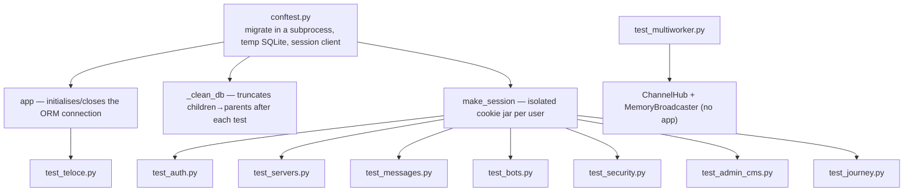

# Lesson 18 — Testing the whole system

> **Track position:** the app runs. Now pin down every promise with a test, so a
> future change cannot quietly break one.

## Goal

A suite that covers auth, authorization, messages, bots, security, admin/CMS, the
compiled SPA, multi-worker fan-out, and one end-to-end user journey — with a
`conftest.py` that makes async + ORM + cookies actually work.

## System design



| Test file | Layer | Needs the app? |
|---|---|---|
| `test_auth.py` | registration, login, session | yes |
| `test_servers.py` | membership, roles, private channels | yes |
| `test_messages.py` | history, pagination, delete rules | yes |
| `test_bots.py` | tokens, commands, events, idempotency | yes |
| `test_security.py` | CSRF, 401s, isolation | yes |
| `test_admin_cms.py` | Admin index, CMS content type | yes |
| `test_teloce.py` | the SPA compiles | yes |
| `test_journey.py` | one scripted end-to-end flow | yes |
| `test_multiworker.py` | hub fan-out | **no** — pure units |

`test_multiworker.py` deliberately needs no app: it proves the hub/broadcaster
contract in isolation, which is why it runs in milliseconds.

## Step 1 — `tests/conftest.py`

Header and the aiosqlite daemon patch:

```python
"""Shared pytest fixtures for the Discord-clone example tests."""
from __future__ import annotations

import asyncio
import os
import subprocess
import sys
import tempfile
from pathlib import Path

import pytest

# aiosqlite's per-connection worker thread is created without daemon=True, so
# Python's interpreter shutdown joins it forever unless the connection is
# explicitly closed (which the admin store's ORM facade never is in-process).
import aiosqlite.core as _aiosqlite_core

_aiosqlite_Connection_init = _aiosqlite_core.Connection.__init__


def _daemon_aiosqlite_connection_init(self, *args, **kwargs):
    _aiosqlite_Connection_init(self, *args, **kwargs)
    if getattr(self, "_thread", None) is not None:
        self._thread.daemon = True


_aiosqlite_core.Connection.__init__ = _daemon_aiosqlite_connection_init

ROOT = Path(__file__).resolve().parent.parent
```

> Without that patch, the suite passes and then **hangs at exit**. The admin
> store opens an ORM connection it never closes; the non-daemon worker thread
> keeps the interpreter alive. Marking it daemon changes shutdown behaviour only.

Migrations in a **subprocess**, against a throwaway database:

```python
@pytest.fixture(scope="session", autouse=True)
def _configure_and_migrate():
    os.environ["DATABASE_URL"] = "sqlite://" + tempfile.mktemp(dir=str(ROOT / "data"), suffix=".sqlite3")
    os.environ["FLAXON_SECRET_KEY"] = "test-secret-key-please-rotate-0123456789"
    os.environ["FLAXON_DEBUG"] = "true"
    os.environ["REDIS_URL"] = ""              # force the in-process MemoryBroadcaster
    os.environ["RATE_LIMIT_ENABLED"] = "false"  # tests share one client IP
    subprocess.run([sys.executable, "management.py", "migrate"], cwd=str(ROOT), check=True)
    yield
```

Why a subprocess: importing `app` builds the **live** app (with Admin, which
queries its store at construction), so tables must exist first — and importing
in-process would cache the management-mode app (no routes) in `sys.modules`.

The `app` fixture binds the ORM explicitly:

```python
@pytest.fixture()
def app():
    from app import app as application

    asyncio.run(_initialize(application))
    yield application
    asyncio.run(_close(application))


async def _initialize(application):
    with application.db.bind():
        await application.db.initialize()


async def _close(application):
    with application.db.bind():
        await application.db.close()


@pytest.fixture(autouse=True)
def _clean_db(app):
    yield
    _truncate(app)
```

`_truncate` deletes **children before parents** — otherwise SQLite's foreign keys
reject the delete halfway through:

```python
        for model in (
            ChannelAccess, Message, Membership, BotMembership, EventDelivery,
            CommandInvocation, SlashCommand, EventSubscription, BotToken,
            Channel, Role, Bot, Server, User,
        ):
            await model.all().delete()
```

## Step 2 — A cookie-aware client

Flaxon's `TestClient` does not persist cookies between requests. Real browsers
do, so wrap it:

```python
class SessionClient:
    """Cookie- and CSRF-aware wrapper around the synchronous Flaxon TestClient."""

    def __init__(self, app) -> None:
        from flaxon.testing import TestClient

        self.client = TestClient(app)
        self.cookies: dict[str, str] = {}
        self.csrf: str | None = None

    def _headers(self, extra):
        headers = dict(extra or {})
        if self.cookies:
            headers["Cookie"] = "; ".join(f"{k}={v}" for k, v in self.cookies.items())
        if self.csrf and "x-csrf-token" not in headers:
            headers["x-csrf-token"] = self.csrf
        return headers

    def _save(self, response) -> None:
        sc = response.headers.get("set-cookie")
        if sc:
            name, _, value = sc.split(";", 1)[0].partition("=")
            self.cookies[name.strip()] = value.strip()

    def _request(self, method, path, **kw):
        if method in ("post", "patch", "delete") and self.csrf is None:
            self.fetch_csrf()
        headers = self._headers(kw.pop("headers", None))
        r = getattr(self.client, method)(path, headers=headers, **kw)
        self._save(r)
        return r

    def get(self, path, **kw): return self._request("get", path, **kw)
    def post(self, path, **kw): return self._request("post", path, **kw)
    def patch(self, path, **kw): return self._request("patch", path, **kw)
    def delete(self, path, **kw): return self._request("delete", path, **kw)

    def register(self, username, email, password):
        return self.post("/api/auth/register",
                         json_data={"username": username, "email": email, "password": password})

    def fetch_csrf(self) -> str:
        self.csrf = self.get("/api/auth/csrf-token").json()["token"]
        return self.csrf


@pytest.fixture()
def client(app):
    return SessionClient(app)


@pytest.fixture()
def make_session(app):
    """Factory for an independent, cookie-isolated session against the same app."""
    def _factory() -> SessionClient:
        return SessionClient(app)

    return _factory
```

`make_session` is what makes multi-user tests honest: two users, two cookie jars,
one app — exactly like two browsers.

## Step 3 — Tests that assert the interesting property

Bot tokens are stored as hashes — checked through the ORM, not through the API:

```python
from __future__ import annotations

import asyncio

from models import BotToken, EventDelivery


def test_token_is_hashed_not_stored_plaintext(app, make_session):
    c = make_session()
    c.register("alice", "alice@example.com", "password123")
    c.fetch_csrf()
    token = c.post("/api/bots/", json_data={"name": "Helper"}).json()["token"]

    async def _check():
        return await BotToken.filter(token_prefix=token[:12]).count()

    with app.db.bind():
        assert asyncio.run(_check()) == 1
```

Event idempotency, end to end:

```python
def test_event_delivery_is_idempotent(app, make_session):
    c = make_session()
    c.register("alice", "alice@example.com", "password123")
    c.fetch_csrf()
    sid = c.post("/api/servers/", json_data={"name": "Guild"}).json()["server"]["id"]
    cid = c.post(f"/api/servers/{sid}/channels", json_data={"name": "general"}).json()["channel"]["id"]
    bot = c.post("/api/bots/", json_data={"name": "Echo"}).json()["bot"]
    c.post(f"/api/bots/{bot['id']}/join", json_data={"server_id": sid})

    c.post(f"/api/channels/{cid}/messages", json_data={"content": f"hi {bot['name']}"})
    c.post(f"/api/channels/{cid}/messages", json_data={"content": f"hi {bot['name']}"})

    async def _count():
        return await EventDelivery.filter(bot_id=bot["id"]).count()

    with app.db.bind():
        assert asyncio.run(_count()) == 2      # two messages → exactly two deliveries
```

The journey test ties the whole system together: register → create a server →
create a channel → add a bot → subscribe it → post a message → assert the bot
replied → revoke the token → assert the next invoke is refused.

## Step 4 — Run it

```bash
python3.11 -m pytest tests/ -p no:asyncio -o addopts="" -q
```

Expected:

```
41 passed in ~5s
```

- `-p no:asyncio` disables pytest-asyncio, which would otherwise try to collect
  the `async def` helpers as coroutine tests.
- `-o addopts=""` clears inherited options from the repo's root config.
- Coverage artifacts (`htmlcov/`, `coverage.xml`) are gitignored — delete them
  before running `python management.py typecheck`, or the typechecker will try to
  parse generated HTML as TypeScript.

## Verify

| Scenario | Expected |
|---|---|
| Full suite | green |
| Run twice in a row | green both times (no leaked state) |
| Delete a single test file | suite still green (no hidden coupling) |
| Set `RATE_LIMIT_ENABLED=true` | rate-limit tests fail — proving the flag is real |

## Why this way

- **One temp database per session, truncated per test.** Tests never see each
  other's rows, and the schema is always fresh.
- **A cookie-aware client, not per-request auth headers.** The tests exercise the
  same session machinery a browser uses.
- **Unit tests where units exist.** The hub/broadcaster contract needs no app, so
  it gets none — fast and deterministic.
- **Assertions target invariants, not status codes.** "1 token row, holding a
  hash" would catch a regression that "200 OK" never would.

## Next

[Lesson 19 — Deployment and hardening](19-deployment.md).
