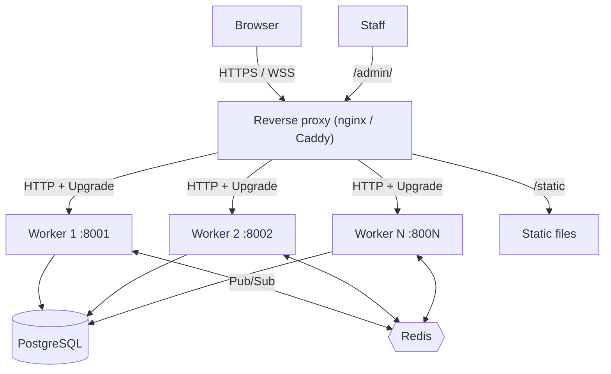
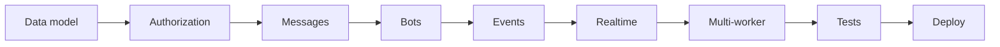

# Lesson 19 — Deployment and hardening

> **Track position:** the system works and is tested. Now ship it.

## Goal

The production topology: Postgres, Redis, N workers behind a reverse proxy, real
secrets, and a hardening checklist you can actually walk.

## System design



What each piece is responsible for:

| Component | Owns | Must not own |
|---|---|---|
| Reverse proxy | TLS, `/static`, WebSocket upgrade, timeouts | application state |
| Worker | request handling, one `ChannelHub` | durable state |
| Postgres | every durable row | — |
| Redis | cross-worker fan-out | anything irreplaceable |
| `.env` | secrets | anything committed |

## Step 1 — Settings for production

`settings.py` already reads everything from the environment; production just
supplies different values:

```python
from flaxon.config import env

DEBUG = env.bool("FLAXON_DEBUG", default=True)
SECRET_KEY = env.str("FLAXON_SECRET_KEY", default="dev-only-discord-secret-change-me-32ch")
ALLOWED_HOSTS = env.list("FLAXON_ALLOWED_HOSTS", default=["localhost", "127.0.0.1", "testserver"])
CSRF_TRUSTED_ORIGINS = env.list("FLAXON_CSRF_TRUSTED_ORIGINS", default=[])
DATABASE_URL = env.str("DATABASE_URL", default=f"sqlite://{DATA_DIR / 'discord.sqlite3'}")
REDIS_URL = env.str("REDIS_URL", default="")
```

Production `.env`:

```bash
FLAXON_DEBUG=false
FLAXON_SECRET_KEY=<python -c "import secrets;print(secrets.token_urlsafe(48))">
FLAXON_ALLOWED_HOSTS=chat.example.com
FLAXON_CSRF_TRUSTED_ORIGINS=https://chat.example.com
DATABASE_URL=postgres://discord:<password>@db-host:5432/discord
REDIS_URL=redis://redis-host:6379/0
```

> `DEBUG=false` is not cosmetic. With debug on, errors render with context that
> includes settings — including the path to your database.

## Step 2 — Migrate, then start N workers

```bash
# once, on deploy
python management.py migrate
python management.py setup-admin

# N workers (systemd, supervisor, or your process manager)
python management.py runserver --host 127.0.0.1 --port 8001
python management.py runserver --host 127.0.0.1 --port 8002
```

Each worker constructs its own `AppContext`, therefore its own `ChannelHub`, and
— because `REDIS_URL` is set — a `RedisBackedBroadcaster`. That is the only
difference from development, and it is one line in `app.py`:

```python
    if getattr(settings, "REDIS_URL", ""):
        from services.broadcaster import RedisBackedBroadcaster

        broadcaster = RedisBackedBroadcaster(settings.REDIS_URL)
    else:
        from services.broadcaster import MemoryBroadcaster

        broadcaster = MemoryBroadcaster()
```

## Step 3 — Reverse proxy

nginx, with the WebSocket upgrade that realtime needs:

```nginx
upstream discord_clone {
    ip_hash;                     # optional: not required, but friendlier
    server 127.0.0.1:8001;
    server 127.0.0.1:8002;
}

server {
    listen 443 ssl http2;
    server_name chat.example.com;

    # TLS certificates …

    location /static/ {
        alias /srv/discord_clone/static/;
        expires 30d;
    }

    location /ws {
        proxy_pass http://discord_clone;
        proxy_http_version 1.1;
        proxy_set_header Upgrade $http_upgrade;
        proxy_set_header Connection "upgrade";
        proxy_set_header Host $host;
        proxy_read_timeout 3600s;      # long-lived socket
        proxy_send_timeout 3600s;
    }

    location / {
        proxy_pass http://discord_clone;
        proxy_set_header Host $host;
        proxy_set_header X-Forwarded-For $proxy_add_x_forwarded_for;
        proxy_set_header X-Forwarded-Proto $scheme;
    }
}
```

Two details that bite:

- **`proxy_read_timeout`** — the default (60s) closes idle WebSockets, and the
  client silently stops receiving events until its 2s reconnect fires.
- **`X-Forwarded-For`** — `_client_ip()` in `context.py` reads it, so without the
  header every user shares the rate-limit bucket of the proxy. That turns a
  per-user limiter into a global one.

## Step 4 — Hardening checklist

| # | Item | Why |
|---|---|---|
| 1 | `FLAXON_DEBUG=false` | no settings in error pages |
| 2 | Real `SECRET_KEY`, 32+ random chars | it signs sessions **and** CSRF tokens |
| 3 | `ALLOWED_HOSTS` set to your domain | Host-header attacks |
| 4 | `CSRF_TRUSTED_ORIGINS` for the HTTPS origin | CSRF rejects the otherwise-unknown referer |
| 5 | TLS everywhere (`wss://` follows) | a `ws://` socket on an HTTPS page is blocked |
| 6 | Postgres, not SQLite | SQLite serialises writes; fine for one worker, fatal for several |
| 7 | Redis reachable from every worker | cross-worker fan-out |
| 8 | `.env` outside the repo, `chmod 600` | no plaintext secrets in version control |
| 9 | `/static` served by the proxy | don't spend a worker on bytes |
| 10 | Rotate bot tokens on staff change | revocation is a row update, use it |

## Step 5 — Operational notes

**Retried deliveries need a scheduler.** `retry_failed_deliveries()` exists but is
not called automatically — wire it to a cron job or a background worker:

```bash
*/5 * * * * cd /srv/discord_clone && python -c "import asyncio; from services.bots import retry_failed_deliveries; print(len(asyncio.run(retry_failed_deliveries())))"
```

**Rate limits are per worker.** With N workers the effective limit is N×. If you
need it exact, back the limiter with Redis — the interface is already isolated
behind `ctx.guard`, so the swap is local.

**Presence resets on deploy.** It is in-memory by design (Lesson 10); clients
re-attach on reconnect. Don't "fix" this by persisting it.

**Backups are just Postgres.** Nothing irreplaceable lives in Redis or in a
worker. Losing Redis costs you live events for the duration; losing Postgres
costs you data.

## Verify

| Scenario | Expected |
|---|---|
| `curl -I https://chat.example.com/` | 200, TLS |
| `curl -I https://chat.example.com/api/nope` | 404 JSON, not HTML |
| Two browsers on different workers | messages cross via Redis |
| Idle socket for 10 minutes | still connected (proxy timeout raised) |
| `SELECT count(*) FROM dc_bot_tokens WHERE revoked_at IS NULL` | only tokens you expect |
| Grep the repo for `SECRET_KEY =` | only the `change-me` default |

## Why this way

- **Workers are disposable.** All durable state is in Postgres; losing a worker
  costs sockets, not data, so N can scale with traffic.
- **Redis is a fan-out channel, not a datastore.** Losing it degrades realtime
  and nothing else — and the hub re-subscribes with backoff when it returns.
- **One env var switches the topology.** Dev and prod take the same code path with
  different injected implementations, so "works on my machine" carries further.
- **The checklist is short on purpose.** Controls that live in code (CSRF,
  authorization, hashing) are already tested by Lesson 16; deployment config is
  only what code cannot guarantee.

## What you built

Nineteen lessons, from `flaxon new` to a multi-worker, bot-extensible, realtime
chat system:



The two ideas worth carrying into your next system:

1. **The live layer is a projection, not a source of truth.** Persist first,
   broadcast second, and every failure mode becomes recoverable.
2. **Extensibility through data, not code.** Bots are rows plus handlers you
   ship. That one constraint is what makes the platform safe to expose.
