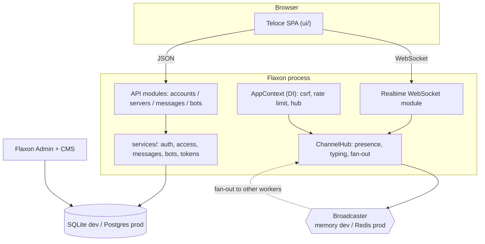

# Build a Discord Clone + Bot Platform on Flaxon

This is a **hands-on** course. You start from an empty directory, run
`flaxon new`, and build the whole system yourself — lesson by lesson. Every
lesson tells you exactly **what to create**, **what code to add**, and **how to
verify** it before moving on.

The finished, tested result lives in
[`examples/discord_clone/`](../../examples/discord_clone/). Treat it as the
reference answer when you get stuck — not as the thing you read first.

## Prerequisites

- Python 3.11+
- `pip install flaxon` (or a checkout of this repository)
- Redis — **only** required by Lesson 11 (multi-worker). Everything before that
  runs on SQLite with an in-memory broadcaster.

## How each lesson is laid out

| Section | What it is for |
|---|---|
| **Goal** | The single increment this lesson adds. |
| **System design** | A diagram plus the senior-engineer reasoning behind the decision. |
| **Steps** | Files to create and code to add, in order. |
| **Verify** | A command or request that proves the increment works. |
| **Why this way** | The trade-off you would defend in a design review. |

## The build track

| # | Lesson | You add | Verify with |
|---|---|---|---|
| 1 | Overview | the mental model | — |
| 2 | Scaffold | `flaxon new`, settings, app factory | `runserver` boots |
| 3 | Data model | `models.py` + migrations | `makemigrations` / `migrate` |
| 4 | Context & DI | `context.py`, `requires("ctx")` | startup failure when missing |
| 5 | Authentication | `services/auth.py`, `modules/accounts.py` | register → `me` |
| 6 | Servers & channels | permission bitmask, `services/access.py` | create server, join by invite |
| 7 | Messages | `services/messages.py`, `modules/messages.py` | send + cursor pagination |
| 8 | Bot tokens & commands | `services/tokens.py`, bot CRUD | token shown once, `/ping` invokes |
| 9 | Bot events | subscriptions, idempotent delivery | 2 messages → exactly 2 deliveries |
| 10 | Realtime hub | `ChannelHub`, WebSocket module | live message + presence |
| 11 | Multi-worker | Redis broadcaster topology | 2 hubs share one broadcaster |
| 12 | Admin | `admin.py` registrations | `/admin/` moderates models |
| 13 | CMS | announcement content type | `/admin/cms/` |
| 14 | The SPA | `ui/` shell, types, API client | `/` returns the app shell |
| 15 | Wiring the UI | WebSocket layer, components | end-to-end in the browser |
| 16 | Security review | CSRF, rate limits, isolation audit | security tests pass |
| 17 | Seed & run | `seed.py` | idempotent second run |
| 18 | Testing | `tests/` + `conftest.py` | full suite green |
| 19 | Deployment | env, workers, hardening | production checklist |

## The system at a glance

Two structural decisions drive everything:

1. **The live layer is not the source of truth.** Messages are durable rows;
   WebSocket traffic is a projection you can always rebuild from history. Only
   presence and typing are genuinely ephemeral, and they are never persisted.
2. **Bots are data, not code.** A bot is a row with tokens, commands, and
   subscriptions; handlers are functions you register in your own process. No
   user-supplied code ever executes, which is what makes the platform safe.

## Conventions used throughout

- **Collection routes carry a trailing slash** (`POST /api/servers/`). Flaxon
  mounts module root routes with one; calling without it hits the SPA catch-all.
- Every mutating route calls `require_csrf(ctx, request)` first.
- Secrets come only from `.env` (gitignored); never committed.
- The broadcaster is in-memory by default; `REDIS_URL` switches to Redis.

## Ready?

Start with [Lesson 1 — Overview](01-overview.md).
